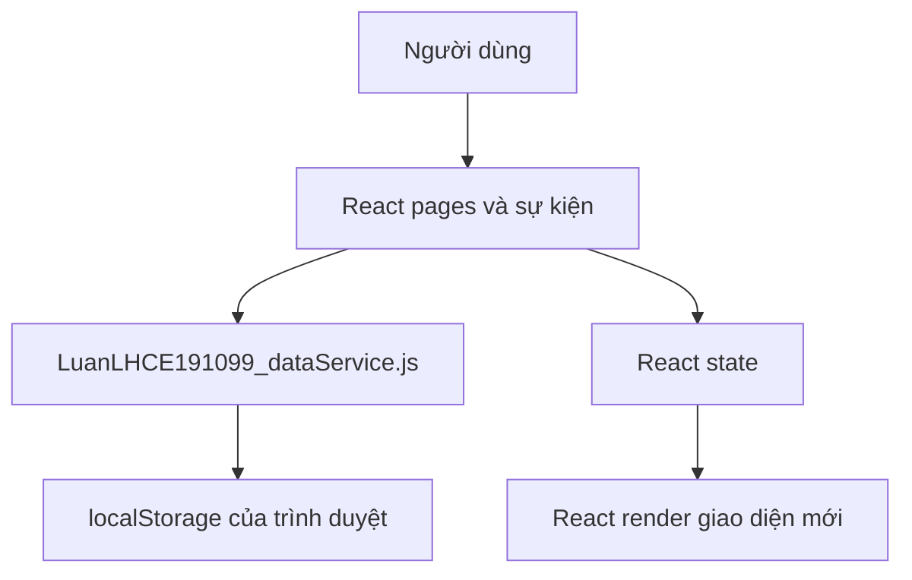
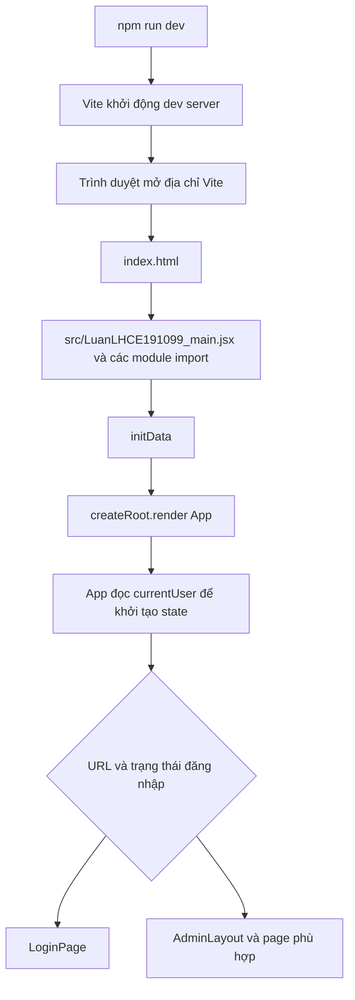
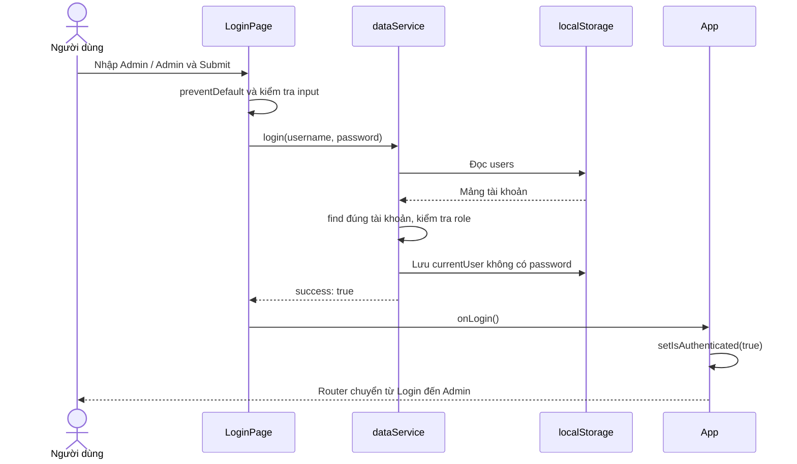
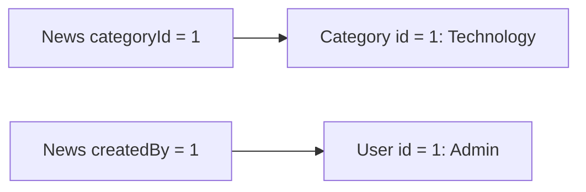

# Assignment 01 — Hướng dẫn kiến trúc, luồng thực thi và code

> **Đọc theo luồng trước:** mở [Hướng dẫn theo luồng và từng file](D:/SBA301/baitaptuhoctungslot/LuanLH_Assignment01/HUONG_DAN_ASSIGNMENT01_THEO_LUONG.md). Bản đó đi theo thao tác mở app → Login → Category CRUD → News/Users → Logout. Tài liệu bên dưới dùng để tra kỹ từng kiến thức sau.

Tài liệu dành cho người mới học React, viết theo code trong project `D:\SBA301\baitaptuhoctungslot\LuanLH_Assignment01`, đối chiếu ngày 28/10/2026.

Mục tiêu: đọc được từng nhóm file, lần theo một thao tác từ lúc bấm nút đến lúc dữ liệu được lưu, giải thích được các câu lệnh chính và tự dựng lại project theo từng bước.

Đây là tài liệu giải thích phiên bản hiện có. Các phần “giới hạn hiện tại” mô tả điều code đang làm; chúng không phải yêu cầu bổ sung hay chức năng đã được cài đặt.

## Mục lục

1. [Ứng dụng làm gì và dữ liệu nằm ở đâu?](#muc-01)
2. [Bản đồ file và trách nhiệm](#muc-02)
3. [Luồng khởi động: từ npm đến giao diện](#muc-03)
4. [JavaScript và JSX cần hiểu trước](#muc-04)
5. [State, props, sự kiện và render](#muc-05)
6. [dataService: dữ liệu mẫu, JSON và localStorage](#muc-06)
7. [Luồng đăng nhập, giữ đăng nhập và đăng xuất](#muc-07)
8. [Router, layout, Sidebar và Outlet](#muc-08)
9. [Đọc CategoryManagement: các biến state](#muc-09)
10. [Create Category: giải thích từng bước](#muc-10)
11. [Update Category và form dùng chung](#muc-11)
12. [Delete Category và kiểm tra quan hệ](#muc-12)
13. [Tìm kiếm, map, key và trạng thái rỗng](#muc-13)
14. [News: quan hệ, tác giả và CRUD](#muc-14)
15. [Users: role, status, trùng tên và tự xóa](#muc-15)
16. [Dashboard và Settings](#muc-16)
17. [Bootstrap, React-Bootstrap và CSS](#muc-17)
18. [Quy luật lập trình và giới hạn của code hiện tại](#muc-18)
19. [Cách chạy, build và kiểm tra kết quả](#muc-19)
20. [Lộ trình tự tái lập project](#muc-20)
21. [Bài tập thực hành và câu hỏi tổng hợp](#muc-21)
22. [Tài liệu chính thức để đọc thêm](#muc-22)

<a id="muc-01"></a>

## 1. Ứng dụng làm gì và dữ liệu nằm ở đâu?

Tên giao diện là **FUNewsManagementSystem**. Đây là ứng dụng quản trị tin tức gồm đăng nhập, Dashboard, Category, News, Users và Settings.

| Chức năng | Hành vi trong project |
|---|---|
| Login | Kiểm tra tài khoản mẫu và chỉ cho role Admin đăng nhập |
| Dashboard | Đếm tổng số Category, News và User |
| Category | Xem, thêm, sửa, xóa, tìm theo tên |
| News | Xem, thêm, sửa, xóa, tìm theo tiêu đề |
| Users | Xem, thêm, sửa, xóa, tìm theo username |
| Settings | Hiện username và role của phiên đăng nhập |
| Logout | Xóa phiên đăng nhập mẫu và đưa người dùng về Login |

Kiến trúc hiện tại:



Các thao tác lưu trong bài này chạy ngay trong trình duyệt. `LuanLHCE191099_dataService.js` không gửi HTTP request: không có Axios, `fetch`, controller, repository hay SQL Server trong luồng Assignment 01 này.

Ví dụ, khi thêm Category, dữ liệu đi theo đường:

```text
Click Save → handleSave → saveCategories → JSON.stringify → localStorage.setItem
                       → setCategories → React render lại bảng
```

Hai nhánh cuối có mục đích khác nhau: `saveCategories` lưu dữ liệu cho lần mở sau; `setCategories` cập nhật dữ liệu dùng để vẽ màn hình hiện tại.

### 1.1. Công nghệ đang dùng

Đối chiếu [package.json](D:/SBA301/baitaptuhoctungslot/LuanLH_Assignment01/package.json):

| Thư viện/công cụ | Vai trò |
|---|---|
| React, React DOM | Component, state và hiển thị lên DOM |
| React Router DOM | Chọn màn hình theo URL và điều hướng SPA |
| React-Bootstrap | Component như `Button`, `Modal`, `Table`, `Form` |
| Bootstrap CSS | Màu, khoảng cách, grid, flex và kiểu của component |
| Lucide React | Icon như `Plus`, `Edit`, `Trash2`, `Search` |
| Vite và plugin React | Chạy môi trường phát triển và tạo bản build |
| Oxlint | Kiểm tra các quy tắc code đã cấu hình |

Project dùng JavaScript: component là `.jsx`, service là `.js`. Không cần đổi sang TypeScript để học lại bài này.

<a id="muc-02"></a>

## 2. Bản đồ file và trách nhiệm

Thư mục gốc: `D:\SBA301\baitaptuhoctungslot\LuanLH_Assignment01`.

| File | Trách nhiệm | Kiến thức cần học |
|---|---|---|
| [package.json](D:/SBA301/baitaptuhoctungslot/LuanLH_Assignment01/package.json) | Khai báo dependencies và lệnh npm | Script, thư viện, module |
| [vite.config.js](D:/SBA301/baitaptuhoctungslot/LuanLH_Assignment01/vite.config.js) | Bật plugin React cho Vite | Cấu hình công cụ build |
| [index.html](D:/SBA301/baitaptuhoctungslot/LuanLH_Assignment01/index.html) | Chứa DOM gốc và nạp entry module | HTML, module script |
| [LuanLHCE191099_main.jsx](D:/SBA301/baitaptuhoctungslot/LuanLH_Assignment01/src/LuanLHCE191099_main.jsx) | Khởi tạo dữ liệu, import CSS và render App | Bootstrap ứng dụng, React root |
| [LuanLHCE191099_App.jsx](D:/SBA301/baitaptuhoctungslot/LuanLH_Assignment01/src/LuanLHCE191099_App.jsx) | Giữ trạng thái đăng nhập và khai báo route | State, callback, điều kiện, routing |
| [LuanLHCE191099_dataService.js](D:/SBA301/baitaptuhoctungslot/LuanLH_Assignment01/src/services/LuanLHCE191099_dataService.js) | Đọc/ghi dữ liệu mẫu và phiên đăng nhập | JSON, localStorage, tìm trong mảng |
| [LuanLHCE191099_LoginPage.jsx](D:/SBA301/baitaptuhoctungslot/LuanLH_Assignment01/src/pages/LuanLHCE191099_LoginPage.jsx) | Form đăng nhập và thông báo lỗi | Controlled input, submit, props |
| [LuanLHCE191099_AdminLayout.jsx](D:/SBA301/baitaptuhoctungslot/LuanLH_Assignment01/src/components/Layout/LuanLHCE191099_AdminLayout.jsx) | Ghép Header, Sidebar và nội dung route con | Composition, Outlet |
| [LuanLHCE191099_Header.jsx](D:/SBA301/baitaptuhoctungslot/LuanLH_Assignment01/src/components/Layout/LuanLHCE191099_Header.jsx) | Logo, tên người dùng, nút Logout | Đọc session, callback lên cha |
| [LuanLHCE191099_Sidebar.jsx](D:/SBA301/baitaptuhoctungslot/LuanLH_Assignment01/src/components/Layout/LuanLHCE191099_Sidebar.jsx) | Menu điều hướng | NavLink, to, end |
| [LuanLHCE191099_CategoryManagement.jsx](D:/SBA301/baitaptuhoctungslot/LuanLH_Assignment01/src/pages/LuanLHCE191099_CategoryManagement.jsx) | CRUD Category và tìm kiếm | State mảng, form dùng chung, validation |
| [LuanLHCE191099_NewsManagement.jsx](D:/SBA301/baitaptuhoctungslot/LuanLH_Assignment01/src/pages/LuanLHCE191099_NewsManagement.jsx) | CRUD News và hiển thị quan hệ | categoryId, createdBy, find |
| [LuanLHCE191099_UserManagement.jsx](D:/SBA301/baitaptuhoctungslot/LuanLH_Assignment01/src/pages/LuanLHCE191099_UserManagement.jsx) | CRUD User và kiểm tra username | some, role, status |
| [LuanLHCE191099_DashboardPage.jsx](D:/SBA301/baitaptuhoctungslot/LuanLH_Assignment01/src/pages/LuanLHCE191099_DashboardPage.jsx) | Đọc số lượng bản ghi | length, Row, Col, Card |
| [LuanLHCE191099_SettingsPage.jsx](D:/SBA301/baitaptuhoctungslot/LuanLH_Assignment01/src/pages/LuanLHCE191099_SettingsPage.jsx) | Hiển thị thông tin phiên đăng nhập | Optional chaining, điều kiện |
| [LuanLHCE191099_index.css](D:/SBA301/baitaptuhoctungslot/LuanLH_Assignment01/src/LuanLHCE191099_index.css) | Reset body và font mặc định | CSS cascade |
| [TEST_MATRIX.md](D:/SBA301/baitaptuhoctungslot/LuanLH_Assignment01/TEST_MATRIX.md) | 35 tình huống kiểm tra thủ công | Input, hành động, kết quả và bằng chứng |

Tên thư mục không tự tạo ra luồng chạy. Ví dụ `services` là cách tổ chức code; trình duyệt biết đến file này vì có câu lệnh `import`.

<a id="muc-03"></a>

## 3. Luồng khởi động: từ npm đến giao diện

### 3.1. Luồng tổng thể



`npm run dev` khởi động công cụ phục vụ file. Code tương tác React được thực thi trong trình duyệt khi anh mở trang.

### 3.2. index.html: chỗ React gắn vào

```html
<div id="root"></div>
<script type="module" src="/src/LuanLHCE191099_main.jsx"></script>
```

| Câu lệnh | Ý nghĩa |
|---|---|
| `id="root"` | Đặt tên cho một phần tử DOM để JavaScript tìm được |
| `type="module"` | Nạp JavaScript theo cơ chế module, có `import`/`export` |
| `src="/src/LuanLHCE191099_main.jsx"` | Chỉ entry module cho Vite phục vụ và biến đổi |

Lúc tải HTML, `root` chưa chứa các bảng CRUD. React tạo giao diện bên trong phần tử đó.

### 3.3. LuanLHCE191099_main.jsx: chuẩn bị rồi render

```jsx
import React from 'react'
import ReactDOM from 'react-dom/client'
import App from './LuanLHCE191099_App.jsx'
import 'bootstrap/dist/css/bootstrap.min.css';
import './LuanLHCE191099_index.css'
import { initData } from './services/LuanLHCE191099_dataService';

initData();

ReactDOM.createRoot(document.getElementById('root')).render(
  <React.StrictMode>
    <App />
  </React.StrictMode>,
)
```

Đọc từng nhóm:

1. Các `import` khai báo module phụ thuộc; Vite xử lý cả import CSS.
2. `initData()` chuẩn bị dữ liệu mẫu trước khi App được render lần đầu.
3. `document.getElementById('root')` lấy phần tử DOM trong HTML.
4. `createRoot(...)` tạo React root gắn với phần tử đó.
5. `.render(...)` yêu cầu React hiển thị cây component bắt đầu từ `App`.

Đoạn chuẩn bị ban đầu này có thể gọi là **bootstrap ứng dụng**. Phân biệt với **Bootstrap CSS**, là thư viện giao diện cũng được dùng trong project.

`StrictMode` bật thêm kiểm tra khi phát triển; React có thể gọi thêm render hoặc initializer để phát hiện vấn đề. Không nên suy ra mỗi `console.log` trong thân component chỉ xuất hiện một lần. [React: StrictMode](https://react.dev/reference/react/StrictMode).

`initData()` đang đứng ngoài cây component. Việc React kiểm tra render của component không đồng nghĩa tự gọi `initData()` hai lần; tải lại module hoặc tải lại trang là chuyện khác.

### 3.4. File không chạy đơn giản từ trên xuống theo thư mục

Sau khi khởi động, ứng dụng chủ yếu chạy do sự kiện:

```text
Gõ input → onChange → setter state → render mới
Bấm Add → onClick → mở Modal → render mới
Bấm Save → handleSave → lưu dữ liệu → cập nhật state → render mới
Bấm menu → Router cập nhật vị trí → hiển thị page tương ứng
```

Khai báo `const handleSave = () => { ... }` tạo hàm. Thân hàm chỉ chạy khi có lời gọi; nó không tự lưu dữ liệu ngay khi đọc tới dòng khai báo.

<a id="muc-04"></a>

## 4. JavaScript và JSX cần hiểu trước

### 4.1. Component và JSX

```jsx
function SettingsPage() {
  return <h2>Settings</h2>;
}
```

`SettingsPage` là function component. JSX mô tả giao diện mà React cần hiển thị. Tên component viết hoa để phân biệt với thẻ HTML như `div`, `h2`.

`return (...)` thường dùng khi JSX dài nhiều dòng. Dấu ngoặc nhóm biểu thức cần trả về; nó không phải một lệnh React riêng.

```jsx
return (
  <div>
    <h2>Settings</h2>
  </div>
);
```

Không xuống dòng ngay sau `return` rồi mới mở ngoặc: JavaScript có thể tự kết thúc câu lệnh `return`, khiến hàm trả về `undefined`.

### 4.2. Dấu ngoặc trong code

| Ký hiệu | Ví dụ | Ý nghĩa trong ví dụ |
|---|---|---|
| `()` | `getUsers()` | Gọi hàm |
| `()` | `(e) => ...` | Danh sách tham số |
| `()` | `condition ? (...) : (...)` | Nhóm biểu thức |
| `{}` | `{ name: 'Sports' }` | Tạo object |
| `{}` | `if (isEdit) { ... }` | Khối lệnh |
| `{}` trong JSX | `<td>{c.name}</td>` | Chuyển sang biểu thức JavaScript |
| `[]` | `[...categories]` | Tạo mảng |
| `[]` | `const [value, setter] = ...` | Destructuring theo vị trí |
| `;` | `setError('');` | Kết thúc câu lệnh theo cách viết tường minh |

### 4.3. Import và export

```jsx
import LoginPage from './pages/LuanLHCE191099_LoginPage';
import { getCurrentUser } from './services/LuanLHCE191099_dataService';
```

Lệnh đầu nhận `default export`; lệnh sau nhận `named export` nên dùng `{}`. Đường dẫn `./` bắt đầu từ file đang import, `../` đi lên một cấp.

IDE có thể tự thêm import nếu nhận ra symbol, nhưng JavaScript vẫn cần khai báo import hợp lệ. Viết `<LoginPage />` không tự tạo ra câu lệnh import khi chạy.

### 4.4. Object, spread và destructuring

```js
const category = { id: 1, name: 'Technology', status: 1 };
const edited = { ...category, name: 'Science' };
```

`...category` chép các thuộc tính vào object mới. `name` ở phía sau ghi đè `name` đã chép. `category` ban đầu vẫn giữ tên cũ.

```js
function LoginPage({ onLogin }) {
  // Lấy thuộc tính onLogin từ object props.
}
```

Đây là destructuring object, không phải gọi hàm `onLogin` ngay lúc nhận props.

### 4.5. Các hàm mảng trong bài

| Hàm | Kết quả | Ví dụ trong project |
|---|---|---|
| `find` | Phần tử đầu tiên phù hợp hoặc `undefined` | Tìm user để đăng nhập |
| `some` | `true` nếu có ít nhất một phần tử phù hợp | Kiểm tra username trùng |
| `filter` | Mảng mới chứa những phần tử thỏa điều kiện | Tìm kiếm hoặc loại bỏ bản ghi |
| `map` | Mảng mới từ kết quả xử lý từng phần tử | Tạo dòng JSX hoặc cập nhật bản ghi |
| `push` | Thêm phần tử vào chính mảng được gọi | Thêm vào bản sao `updatedCats` |

`c`, `n`, `u` là tên tham số do lập trình viên đặt, lần lượt đại diện từng Category, News, User trong callback. Có thể đổi thành `category`, `newsItem`, `user` nếu đổi nhất quán trong callback đó.

### 4.6. So sánh, chuyển kiểu và điều kiện

```js
1 === '1'          // false: khác kiểu
1 === Number('1')  // true
```

`Form.Select` trả giá trị chuỗi qua `e.target.value`, nên code chuyển `role`, `status`, `categoryId` về số trước khi lưu.

```jsx
{error && <Alert variant="danger">{error}</Alert>}
```

Khi `error` là chuỗi khác rỗng, giao diện hiện Alert. Khi `error` là `''`, phần Alert không hiện.

```js
user?.username
```

`?.` dừng truy cập nếu `user` là `null` hoặc `undefined`, tránh lỗi do đọc thuộc tính của giá trị không tồn tại. Nó không xác minh tính hợp lệ của user.

<a id="muc-05"></a>

## 5. State, props, sự kiện và render

### 5.1. State là dữ liệu component cần nhớ

```jsx
const [searchKw, setSearchKw] = useState('');
```

`searchKw` là giá trị ở render hiện tại; `setSearchKw` yêu cầu React cập nhật state cho render tiếp theo; `''` là giá trị khởi tạo. Gán vào biến thường không cung cấp cơ chế nhớ và yêu cầu render như state. [React: State](https://react.dev/learn/state-a-components-memory).

Code không gọi `CategoryManagement()` sau mỗi nút bấm. React quản lý việc gọi component để tính giao diện mới.

### 5.2. Khởi tạo lười bằng hàm

```jsx
const [categories, setCategories] = useState(() => getCategories());
```

React dùng hàm này để tạo state ban đầu khi component được khởi tạo. Các render tiếp theo giữ state đã có; không đọc lại storage thành state mới ở mỗi lần gõ input. Trong StrictMode khi phát triển, initializer có thể được gọi thêm để kiểm tra. [React: useState](https://react.dev/reference/react/useState).

Khi rời route rồi quay lại khiến page được mount mới, state page được khởi tạo lại từ storage.

### 5.3. Setter không đổi biến ngay trong hàm đang chạy

```js
setSearchKw('react');
console.log(searchKw);
```

Log này vẫn đọc `searchKw` của render hiện tại. Đừng dùng nó để kết luận setter bị hỏng. Giao diện render tiếp theo sẽ dùng state mới. [React: useState](https://react.dev/reference/react/useState).

### 5.4. Controlled input

```jsx
<Form.Control
  value={searchKw}
  onChange={(e) => setSearchKw(e.target.value)}
/>
```

Luồng trong code:

```text
Anh gõ “tech”
→ input phát sự kiện change
→ e.target.value là “tech”
→ setSearchKw('tech')
→ render mới tính lại filteredCategories
→ bảng hiện các Category phù hợp
```

`value` lấy từ state; `onChange` cập nhật state. Hai phần tạo thành đường đi để React điều khiển giá trị input.

### 5.5. Props đi xuống, callback thông báo lên

```jsx
<LoginPage onLogin={handleLogin} />
```

`App` truyền một hàm xuống qua props. Khi đăng nhập thành công, `LoginPage` gọi `onLogin()`. Hàm thực sự chạy là `handleLogin` được khai báo trong `App`, nên App cập nhật state của chính mình.

### 5.6. Truyền hàm và gọi hàm

```jsx
onClick={handleShowAdd}
onClick={() => handleShowEdit(c)}
```

Trường hợp đầu chuyển hàm cho React gọi khi click. Trường hợp sau chuyển một hàm nhỏ để lúc click mới gọi `handleShowEdit` với Category của dòng đó.

Nếu viết `onClick={handleShowEdit(c)}`, hàm bị gọi ngay khi render và giá trị trả về được đưa vào `onClick`. Đây là lỗi khác với việc thiếu tham số.

### 5.7. Vì sao state và localStorage phải cập nhật riêng?

| Thao tác | Màn hình hiện tại | Sau F5 |
|---|---|---|
| Chỉ `setCategories(updatedCats)` | Có thể hiện dữ liệu mới | Đọc lại dữ liệu cũ trong storage |
| Chỉ `saveCategories(updatedCats)` | State page vẫn giữ dữ liệu cũ | Page khởi tạo lại sẽ đọc được dữ liệu mới |
| Gọi cả hai như hiện tại | State được cập nhật | Storage giữ được dữ liệu đã lưu |

Không có đoạn code nào trong bài tự lắng nghe mọi thay đổi `localStorage` rồi đồng bộ state. Hai nơi này được đồng bộ tường minh trong các handler lưu/xóa.

<a id="muc-06"></a>

## 6. dataService: dữ liệu mẫu, JSON và localStorage

Mở [LuanLHCE191099_dataService.js](D:/SBA301/baitaptuhoctungslot/LuanLH_Assignment01/src/services/LuanLHCE191099_dataService.js).

### 6.1. Mô hình dữ liệu

```js
// User mẫu
{ id: 1, username: 'Admin', password: 'Admin', role: 1, status: 1 }

// Category mẫu
{ id: 1, name: 'Technology', status: 1 }

// News mẫu
{
  id: 1,
  title: 'React 19 Release',
  content: 'React 19 is coming...',
  categoryId: 1,
  createdBy: 1,
  status: 1,
  tags: 'react, js'
}
```

Tên và nội dung News ở đây là dữ liệu minh họa, không phải thông báo phiên bản React hiện tại.

| Trường | Ý nghĩa |
|---|---|
| `id` | Định danh một bản ghi trong mảng |
| `role` | `1`: Admin; `2`: Staff trong các tài khoản mẫu |
| `status` | `1`: Active; `0`: Inactive khi hiển thị |
| `categoryId` | Tham chiếu đến `id` của Category |
| `createdBy` | Tham chiếu đến `id` của User tạo News |
| `tags` | Chuỗi văn bản như `'react, js'`, chưa phải mảng Tag riêng |

### 6.2. Bốn key lưu trong trình duyệt

| Key | Nội dung |
|---|---|
| `users` | Chuỗi JSON của mảng tài khoản, gồm mật khẩu mẫu |
| `categories` | Chuỗi JSON của mảng Category |
| `news` | Chuỗi JSON của mảng News |
| `currentUser` | Chuỗi JSON của user đang đăng nhập, được lược bỏ password |

`localStorage` lưu cặp key/value dạng chuỗi, gắn với origin của trang và thường tồn tại qua lần đóng/mở trình duyệt. Origin gồm giao thức, hostname và cổng; `localhost:5173` và `localhost:5174` có vùng lưu trữ khác nhau. [MDN: localStorage](https://developer.mozilla.org/en-US/docs/Web/API/Window/localStorage).

### 6.3. initData không ghi đè dữ liệu sau mỗi F5

Ví dụ với Category:

```js
if (!localStorage.getItem('categories')) {
  localStorage.setItem('categories', JSON.stringify(initialCategories));
}
```

Chưa có key thì tạo dữ liệu mẫu. Đã có key thì giữ dữ liệu anh thêm/sửa/xóa.

Một mảng rỗng được lưu thành chuỗi `'[]'`. Chuỗi này là truthy, nên xóa hết Category không làm dữ liệu mẫu tự xuất hiện lại khi F5.

Đổi `initialCategories` trong source cũng không tự sửa key `categories` đã tồn tại. Khi thử dữ liệu mẫu khác, phải chủ động xử lý dữ liệu cũ; không nhầm với lỗi React không render.

### 6.4. Đoạn migration tài khoản mẫu

`initData()` còn tìm tài khoản mẫu cũ có `username === 'admin'`, `password === '123'`, `role === 1` rồi đổi thành `Admin` / `Admin` bằng `map`.

Nó chỉ thay bản ghi mẫu tìm được, giữ các tài khoản khác. Nếu phiên hiện tại khớp tài khoản mẫu cũ, code xóa `currentUser` để đăng nhập lại.

Đây là xử lý chuyển dữ liệu cũ của bản demo; không phải quy tắc tất cả tài khoản phải đổi tên thành Admin.

### 6.5. Hàm đọc/ghi dùng chung

```js
const getItems = (key) => JSON.parse(localStorage.getItem(key)) || [];
const saveItems = (key, items) => localStorage.setItem(key, JSON.stringify(items));

export const getCategories = () => getItems('categories');
export const saveCategories = (cats) => saveItems('categories', cats);
```

| Câu lệnh | Làm gì? |
|---|---|
| `getItem(key)` | Lấy chuỗi được lưu, hoặc `null` nếu chưa có key |
| `JSON.parse(...)` | Chuyển JSON về giá trị JavaScript |
| `|| []` | Dùng mảng rỗng nếu kết quả đọc là falsy |
| `JSON.stringify(items)` | Chuyển mảng/object sang JSON |
| `setItem(key, ...)` | Ghi lại giá trị của cả key |
| `export` | Cho module khác import hàm |

`|| []` không bắt được lỗi JSON sai cú pháp: `JSON.parse` vẫn ném lỗi trước khi tới phép `||`. Code hiện tại chưa có `try/catch` cho trường hợp storage bị sửa thành JSON không hợp lệ.

Service hiện ghi lại **cả mảng**, không có câu lệnh SQL `INSERT` từng dòng. Những hàm này chạy đồng bộ nên caller nhận kết quả trực tiếp, chưa cần `await`.

<a id="muc-07"></a>

## 7. Luồng đăng nhập, giữ đăng nhập và đăng xuất

### 7.1. Toàn bộ đường đi khi Login thành công



### 7.2. LoginPage xử lý form

Mở [LuanLHCE191099_LoginPage.jsx](D:/SBA301/baitaptuhoctungslot/LuanLH_Assignment01/src/pages/LuanLHCE191099_LoginPage.jsx):

```jsx
const handleSubmit = (e) => {
  e.preventDefault();
  setError('');

  if (!username || !password) {
    setError('Please enter both username and password.');
    return;
  }

  const res = login(username, password);
  if (res.success) {
    onLogin();
  } else {
    setError(res.message);
  }
};
```

| Dòng/nhóm lệnh | Giải thích |
|---|---|
| `(e)` | Nhận event submit từ Form |
| `e.preventDefault()` | Ngăn hành vi submit mặc định làm tải/chuyển trang |
| `setError('')` | Xóa thông báo cũ trước lần kiểm tra mới |
| `!username || !password` | Chặn chuỗi rỗng ở một trong hai ô |
| `return` trong nhánh lỗi | Dừng handler, không gọi `login` tiếp |
| `login(username, password)` | Gọi hàm service với state hiện tại |
| `res.success` | Kiểm tra cờ kết quả service trả về |
| `onLogin()` | Thông báo thành công cho App |
| `setError(res.message)` | Hiển thị lỗi service cung cấp |

Code kiểm tra chuỗi rỗng ở đây chưa `trim()` username/password. Tài khoản đăng nhập được so khớp chính xác, phân biệt hoa/thường: `Admin` khác `admin`.

### 7.3. login trong service

```js
const users = getUsers();
const user = users.find(u => u.username === username && u.password === password);
```

`find` tìm một object khớp cả hai điều kiện. Có user rồi, code tiếp tục kiểm tra `user.role === 1`.

Khi được chấp nhận, service tạo object:

```js
const authenticatedUser = {
  id: user.id,
  username: user.username,
  role: user.role,
  status: user.status
};
localStorage.setItem('currentUser', JSON.stringify(authenticatedUser));
return { success: true, user: authenticatedUser };
```

Password không được chép sang `currentUser`. Tuy vậy password mẫu vẫn tồn tại trong key `users`; đây là đăng nhập giả lập để thực hành frontend.

Hai nhánh lỗi:

| Trường hợp | Kết quả |
|---|---|
| Đúng username/password nhưng role khác `1` | `Only Admin can login to this system.` |
| Không có tài khoản khớp | `Invalid username or password.` |

Code hiện **không kiểm tra `status` khi login**. Tài khoản Admin Inactive vẫn có thể qua hàm này nếu đúng username/password. Phân biệt dữ liệu có thuộc tính status với việc đã dùng status để quyết định quyền truy cập.

### 7.4. App giữ trạng thái đăng nhập

Mở [LuanLHCE191099_App.jsx](D:/SBA301/baitaptuhoctungslot/LuanLH_Assignment01/src/LuanLHCE191099_App.jsx):

```jsx
const [isAuthenticated, setIsAuthenticated] = useState(() => Boolean(getCurrentUser()));

const handleLogin = () => {
  setIsAuthenticated(true);
};

const handleLogout = () => {
  setIsAuthenticated(false);
};
```

`getCurrentUser()` trả object nếu có phiên, hoặc `null` nếu không. `Boolean(...)` chuyển kết quả sang `true`/`false`.

Sau F5, state React cũ mất, nhưng initializer đọc lại `currentUser` từ storage để quyết định trạng thái ban đầu.

Lưu phiên vào storage là việc của service; thay đổi state để Router phản ứng ngay là việc của callback trong App.

### 7.5. Logout đi qua những file nào?

```text
Header: click Logout
→ Header.handleLogout()
→ dataService.logout(): removeItem('currentUser')
→ onLogout() được truyền qua AdminLayout từ App
→ App.handleLogout(): setIsAuthenticated(false)
→ route Admin trả về Navigate to="/login"
→ LoginPage xuất hiện
```

`logout()` chỉ xóa key `currentUser`. Các mảng `users`, `categories`, `news` còn nguyên.

Nếu chỉ xóa storage mà không gọi callback, App hiện tại chưa được yêu cầu thay đổi state. Nếu chỉ đổi state mà không xóa storage, F5 có thể đọc lại phiên cũ.

### 7.6. Authentication và authorization trong bài

| Khái niệm | Đoạn code minh họa |
|---|---|
| Authentication: tài khoản có khớp không? | `find` theo username/password |
| Authorization: role đó có được vào Admin không? | `user.role === 1` khi login |
| Điều hướng theo trạng thái UI | App chọn `AdminLayout` hoặc `Navigate` |

Các kiểm tra này đều ở frontend và dữ liệu có thể được sửa bằng DevTools. App khi khôi phục phiên chỉ kiểm tra có object `currentUser`, chưa xác minh lại role/status với một server. Đây là giới hạn của phiên bản học tập hiện tại.

<a id="muc-08"></a>

## 8. Router, layout, Sidebar và Outlet

### 8.1. Bảng route

| URL | Component nội dung | Điều kiện |
|---|---|---|
| `/login` | LoginPage | Chưa đăng nhập; nếu đã đăng nhập thì chuyển `/` |
| `/` | DashboardPage trong AdminLayout | `isAuthenticated` là true |
| `/category` | CategoryManagement trong AdminLayout | Qua route cha Admin |
| `/news` | NewsManagement trong AdminLayout | Qua route cha Admin |
| `/users` | UserManagement trong AdminLayout | Qua route cha Admin |
| `/settings` | SettingsPage trong AdminLayout | Qua route cha Admin |

### 8.2. Router chọn giao diện, không thực hiện CRUD

Đoạn chính trong [LuanLHCE191099_App.jsx](D:/SBA301/baitaptuhoctungslot/LuanLH_Assignment01/src/LuanLHCE191099_App.jsx):

```jsx
<Router>
  <Routes>
    <Route path="/login" element={
      !isAuthenticated ? <LoginPage onLogin={handleLogin} /> : <Navigate to="/" />
    } />

    <Route path="/" element={
      isAuthenticated ? <AdminLayout onLogout={handleLogout} /> : <Navigate to="/login" />
    }>
      <Route index element={<DashboardPage />} />
      <Route path="category" element={<CategoryManagement />} />
      <Route path="news" element={<NewsManagement />} />
      <Route path="users" element={<UserManagement />} />
      <Route path="settings" element={<SettingsPage />} />
    </Route>
  </Routes>
</Router>
```

| Thành phần | Ý nghĩa trong code |
|---|---|
| `BrowserRouter as Router` | Import BrowserRouter với tên viết ngắn là Router |
| `Routes` | Chứa cây khai báo route |
| `Route path` | Mẫu đường dẫn để khớp URL |
| `element` | Phần tử React cần hiển thị khi khớp |
| `Navigate` | Chuyển sang vị trí khác khi được render |
| Route con `path="category"` | Ghép với đường dẫn cha thành `/category` |
| Route `index` | Nội dung mặc định khi ở đúng URL cha `/` |

Route lồng nhau hiển thị nội dung con thông qua `Outlet` của component cha. [React Router 7: Routing](https://reactrouter.com/7.18.4/start/declarative/routing).

### 8.3. AdminLayout ghép khung chung

Mở [LuanLHCE191099_AdminLayout.jsx](D:/SBA301/baitaptuhoctungslot/LuanLH_Assignment01/src/components/Layout/LuanLHCE191099_AdminLayout.jsx):

```jsx
function AdminLayout({ onLogout }) {
  return (
    <div className="d-flex flex-column vh-100">
      <Header onLogout={onLogout} />
      <div className="d-flex flex-grow-1 overflow-hidden">
        <Sidebar />
        <main className="flex-grow-1 p-4 bg-light overflow-auto">
          <Outlet />
        </main>
      </div>
    </div>
  );
}
```

Khung có Header ở trên, Sidebar bên trái, page ở vùng `main`. Ở `/news`, Outlet hiển thị `NewsManagement`; ở `/users`, nó hiển thị `UserManagement`.

`Outlet` không gọi service để tải News. Nó là vị trí hiển thị; code của page tương ứng mới đọc dữ liệu page cần.

### 8.4. Sidebar điều hướng

Mở [LuanLHCE191099_Sidebar.jsx](D:/SBA301/baitaptuhoctungslot/LuanLH_Assignment01/src/components/Layout/LuanLHCE191099_Sidebar.jsx):

```jsx
<Nav.Link as={NavLink} to="/category" className="text-white">
  <Folder size={18} className="me-2" />
  Category
</Nav.Link>
```

`Nav.Link` cung cấp cách hiển thị của React-Bootstrap; `as={NavLink}` dùng thành phần điều hướng của Router; `to` là URL đích.

Với Dashboard:

```jsx
<Nav.Link as={NavLink} to="/" end className="text-white">
```

`end` giúp link `/` chỉ được đánh dấu active khi khớp hết đường dẫn, tránh Dashboard cũng active khi đang ở `/category`.

Luồng click Category:

```text
Sidebar NavLink
→ Router đổi location thành /category
→ khớp route cha / và route con category
→ AdminLayout tiếp tục làm khung
→ Outlet hiển thị CategoryManagement
→ page khởi tạo categories từ getCategories()
→ render ô tìm kiếm, bảng và các Modal
```

Các link menu này điều hướng trong SPA. Riêng `Navbar.Brand href="/"` trong Header hiện dùng href thông thường, có thể tải lại toàn trang khi bấm logo/tên ứng dụng.

<a id="muc-09"></a>

## 9. Đọc CategoryManagement: các biến state

Mở [LuanLHCE191099_CategoryManagement.jsx](D:/SBA301/baitaptuhoctungslot/LuanLH_Assignment01/src/pages/LuanLHCE191099_CategoryManagement.jsx). Học kỹ page này trước, vì News và Users lặp lại phần lớn cách tổ chức.

### 9.1. Từng state có một nhiệm vụ

| State | Giá trị ban đầu | Trả lời câu hỏi |
|---|---|---|
| `categories` | `getCategories()` | Page đang có những Category nào? |
| `searchKw` | `''` | Anh đang tìm bằng từ khóa nào? |
| `showModal` | `false` | Có hiện form Add/Edit không? |
| `isEdit` | `false` | Form đang sửa hay thêm? |
| `currentId` | `null` | Nếu sửa thì đang sửa id nào? |
| `formData` | `{ name: '', status: 1 }` | Nội dung anh đang nhập trong form là gì? |
| `formError` | `''` | Có thông báo kiểm tra input nào cần hiện? |
| `showDeleteModal` | `false` | Có hiện hộp xác nhận xóa không? |
| `deleteId` | `null` | Nếu xác nhận thì xóa id nào? |

Không phải biến state nào cũng được lưu storage. Ví dụ `showModal` chỉ điều khiển giao diện; F5 không cần mở lại hộp thoại cũ.

### 9.2. Dữ liệu trong form là bản nháp

```jsx
<Form.Control
  type="text"
  value={formData.name}
  onChange={(e) => setFormData({ ...formData, name: e.target.value })}
/>
```

`...formData` giữ các trường còn lại, ví dụ `status`. Trường `name` được ghi đè bằng nội dung mới.

Nếu viết `setFormData({ name: e.target.value })`, object state mới không còn `status` vì setter này thay toàn bộ object, không tự gộp thuộc tính.

Gõ vào form mới thay đổi `formData`. Mảng `categories` và storage chỉ được đổi khi bấm Save và đi qua validation.

<a id="muc-10"></a>

## 10. Create Category: giải thích từng bước

### 10.1. Bấm Add để chuẩn bị form

```jsx
const handleShowAdd = () => {
  setIsEdit(false);
  setFormData({ name: '', status: 1 });
  setCurrentId(null);
  setShowModal(true);
};
```

| Câu lệnh | Mục đích |
|---|---|
| `setIsEdit(false)` | Save sẽ đi vào nhánh thêm mới |
| `setFormData(...)` | Làm trống tên và chọn Active mặc định |
| `setCurrentId(null)` | Bỏ id của lần sửa trước |
| `setShowModal(true)` | Hiện hộp thoại |

Lúc này chưa có Category nào được thêm. Mở form và lưu bản ghi là hai thao tác khác nhau.

### 10.2. handleSave đầy đủ

```jsx
const handleSave = () => {
  if (!formData.name.trim()) {
    setFormError('Name is required');
    return;
  }

  let updatedCats = [...categories];
  if (isEdit) {
    updatedCats = updatedCats.map(c => c.id === currentId
      ? { ...c, ...formData, status: Number(formData.status) }
      : c);
  } else {
    const newId = updatedCats.length > 0
      ? Math.max(...updatedCats.map(c => c.id)) + 1
      : 1;
    updatedCats.push({ id: newId, ...formData, status: Number(formData.status) });
  }

  saveCategories(updatedCats);
  setCategories(updatedCats);
  handleCloseModal();
};
```

Đoạn này giữ nguyên logic source, chỉ xuống dòng dài cho dễ đọc.

### 10.3. Kiểm tra input

```js
if (!formData.name.trim()) {
  setFormError('Name is required');
  return;
}
```

`trim()` tạo chuỗi bỏ khoảng trắng hai đầu. Tên `'   '` trở thành `''`, bị chặn. `return` ngăn các lệnh lưu phía sau chạy tiếp.

Code dùng kết quả trim để **kiểm tra**, nhưng lúc lưu vẫn dùng `formData.name` gốc. Vì vậy `'  Science  '` được chấp nhận và còn khoảng trắng trong dữ liệu đã lưu.

### 10.4. Tạo mảng làm việc

```js
let updatedCats = [...categories];
```

Đây là mảng mới, chứa các tham chiếu phần tử hiện tại. Nhánh thêm `push` vào mảng mới này, không `push` trực tiếp vào mảng state cũ.

Khi cập nhật phần tử, nhánh sửa còn tạo object mới bằng spread. Với dữ liệu phẳng của Category, cách này giữ được nguyên tắc tạo mảng/object thay thế khi cập nhật state. [React: Updating Arrays](https://react.dev/learn/updating-arrays-in-state).

### 10.5. Sinh id

```js
const newId = updatedCats.length > 0
  ? Math.max(...updatedCats.map(c => c.id)) + 1
  : 1;
```

Ví dụ id đang có là `[1, 2, 5]`:

1. `map(c => c.id)` tạo `[1, 2, 5]`.
2. `...` truyền các số thành đối số riêng: `Math.max(1, 2, 5)`.
3. `Math.max` trả `5`.
4. Cộng `1` được `6`.
5. Nếu mảng rỗng thì chọn `1`, tránh tính max trên mảng rỗng.

Đây là quy ước id trong demo trình duyệt. Nó không có cơ chế cấp id hoặc khóa đồng thời như database; xóa bản ghi id lớn nhất có thể khiến id đó được dùng lại ở lần thêm sau.

### 10.6. Thêm object, lưu và render

```js
updatedCats.push({ id: newId, ...formData, status: Number(formData.status) });
saveCategories(updatedCats);
setCategories(updatedCats);
handleCloseModal();
```

Thứ tự thuộc tính giúp `status` cuối cùng là số dù `formData.status` trước đó là chuỗi `'1'` hoặc `'0'`.

`handleCloseModal()` đặt `showModal` về false và xóa `formError`. React xử lý các yêu cầu state để render bảng với danh sách mới và đóng form.

### 10.7. Theo dõi ví dụ thực tế

Giả sử danh sách chỉ có id `1`, `2`, `3`. Anh nhập `Science`, chọn Active rồi Save:

```text
formData = { name: 'Science', status: '1' }
isEdit = false
→ validation đạt
→ sao chép categories
→ newId = 4
→ thêm { id: 4, name: 'Science', status: 1 }
→ ghi key categories
→ cập nhật state categories
→ đóng Modal
→ bảng tính lại bộ lọc và hiện bản ghi nếu khớp từ khóa hiện tại
```

Nếu đang tìm `'sports'`, bản ghi Science đã được lưu nhưng không khớp bộ lọc nên chưa hiện. Xóa từ khóa để nhìn toàn bộ danh sách.

<a id="muc-11"></a>

## 11. Update Category và form dùng chung

### 11.1. Chọn đúng bản ghi

Nút ở mỗi dòng:

```jsx
<Button onClick={() => handleShowEdit(c)}>
  <Edit size={16} />
</Button>
```

Hàm nhận object Category của dòng được click:

```jsx
const handleShowEdit = (category) => {
  setIsEdit(true);
  setFormData({ name: category.name, status: category.status });
  setCurrentId(category.id);
  setShowModal(true);
};
```

Form có dữ liệu cũ để sửa, `currentId` xác định bản ghi đích. Không dùng tên hoặc số thứ tự dòng để nhận diện, vì tên có thể trùng và vị trí có thể đổi do tìm kiếm/xóa.

### 11.2. map chỉ thay phần tử có id phù hợp

```js
updatedCats = updatedCats.map(c => c.id === currentId
  ? { ...c, ...formData, status: Number(formData.status) }
  : c);
```

Ví dụ đang sửa id `2`:

| Phần tử | Điều kiện | Giá trị trả về callback |
|---|---|---|
| id `1` | Sai | Object cũ `c` |
| id `2` | Đúng | Object mới ghép dữ liệu cũ và formData |
| id `3` | Sai | Object cũ `c` |

`map` vẫn tạo mảng đủ ba phần tử; thao tác sửa không tự tăng số lượng bản ghi.

`{ ...c, ...formData }` giữ `id` từ object cũ vì `formData` Category không chứa `id`, rồi thay `name`/`status`.

### 11.3. Một Modal phục vụ hai chế độ

```jsx
<Modal show={showModal} onHide={handleCloseModal}>
  <Modal.Header closeButton>
    <Modal.Title>{isEdit ? 'Edit Category' : 'Add Category'}</Modal.Title>
  </Modal.Header>
  {/* Form và các nút */}
</Modal>
```

`showModal` quyết định hiện/ẩn; `isEdit` quyết định tiêu đề và nhánh Save; `currentId` chọn bản ghi khi sửa. Ba state này giải quyết ba câu hỏi khác nhau.

Cancel gọi `handleCloseModal()` mà không gọi `saveCategories`, nên bản nháp chưa được lưu. Khi mở Add/Edit lần sau, handler tương ứng đặt lại formData.

<a id="muc-12"></a>

## 12. Delete Category và kiểm tra quan hệ

### 12.1. Nút xóa trước tiên gọi confirmDelete

```jsx
onClick={() => confirmDelete(c.id)}
```

Code thực tế:

```js
const confirmDelete = (id) => {
  const categoryIsUsed = getNews().some(
    newsItem => Number(newsItem.categoryId) === Number(id)
  );
  if (categoryIsUsed) {
    window.alert('This category is used by news articles and cannot be deleted.');
    return;
  }
  setDeleteId(id);
  setShowDeleteModal(true);
};
```

`getNews()` đọc danh sách News từ storage tại thời điểm click. `some` kiểm tra có bài nào đang tham chiếu Category này không. Chỉ cần một bài phù hợp là kết quả true.

Ví dụ News có `categoryId: 1`, xóa Category id `1` bị chặn để không để News trỏ đến Category đã mất. Điều kiện này xét mọi News trong mảng, kể cả News có status Inactive.

Đây là kiểm tra bằng JavaScript trong giao diện. `localStorage` không tự có foreign key để bảo vệ dữ liệu khi ai đó sửa trực tiếp storage.

### 12.2. Xác nhận mới thực sự xóa

```js
const handleDelete = () => {
  const updatedCats = categories.filter(c => c.id !== deleteId);
  saveCategories(updatedCats);
  setCategories(updatedCats);
  setShowDeleteModal(false);
};
```

`filter` giữ những Category có id **khác** id cần xóa. Nó tạo mảng mới và không sửa trực tiếp mảng cũ.

```text
Bấm icon Trash
→ kiểm tra quan hệ
→ lưu deleteId
→ mở xác nhận
→ bấm Delete trong xác nhận
→ filter loại id đó
→ lưu storage
→ đổi state
→ đóng xác nhận
```

Nếu Cancel hoặc đóng hộp xác nhận thì chỉ đổi `showDeleteModal`, không gọi `handleDelete`, nên dữ liệu vẫn còn.

Kiểm tra quan hệ nằm trước lúc mở xác nhận. Code hiện chưa kiểm tra lại trong `handleDelete`, nên không xử lý thay đổi dữ liệu đồng thời giữa hai thời điểm đó.

<a id="muc-13"></a>

## 13. Tìm kiếm, map, key và trạng thái rỗng

### 13.1. Lọc danh sách hiển thị

```js
const filteredCategories = categories.filter(c =>
  c.name.toLowerCase().includes(searchKw.toLowerCase())
);
```

Ví dụ `Technology` và từ khóa `TECH`: cả hai đổi sang chữ thường rồi so khớp, nên bản ghi được giữ lại.

| Biến | Vai trò |
|---|---|
| `categories` | Dữ liệu nguồn của page |
| `searchKw` | Từ khóa đang nhập |
| `filteredCategories` | Kết quả tính từ nguồn và từ khóa trong render hiện tại |

Không gọi `setCategories(filteredCategories)` trong luồng tìm kiếm. Nếu ghi đè nguồn bằng kết quả lọc, có thể mất các phần tử cần tìm lại.

Chuỗi nào cũng `includes('')`, nên xóa nội dung tìm kiếm khiến toàn bộ Category hiện lại mà không cần một nút “Reset dữ liệu”. Tìm kiếm hiện không bỏ dấu tiếng Việt và không trim từ khóa.

### 13.2. map biến dữ liệu thành JSX

```jsx
filteredCategories.map(c => (
  <tr key={c.id}>
    <td>{c.id}</td>
    <td>{c.name}</td>
  </tr>
))
```

Mỗi callback trả về một dòng bảng. `key={c.id}` cung cấp danh tính ổn định cho React đối chiếu các phần tử qua render; `key` không phải ô hiển thị và không phải lệnh lấy dữ liệu từ storage.

Ở ví dụ này, `map(c => (...))` trả về JSX trực tiếp. Nếu đổi thành thân hàm có `{}`:

```jsx
filteredCategories.map(c => {
  return <tr key={c.id}><td>{c.name}</td></tr>;
})
```

Phải có `return`. Viết `{ <tr>...</tr> }` mà không return khiến callback trả `undefined` và không tạo dòng như mong muốn.

### 13.3. Không có kết quả

Code chọn giữa danh sách dòng và một dòng báo rỗng bằng biểu thức ba ngôi:

```jsx
filteredCategories.length > 0 ? (...) : (...)
```

`colSpan="4"` của ô thông báo gộp bốn cột ID, Name, Status, Actions. Trường hợp nguồn rỗng và trường hợp có nguồn nhưng từ khóa không khớp đều dẫn đến bảng không có kết quả.

<a id="muc-14"></a>

## 14. News: quan hệ, tác giả và CRUD

Mở [LuanLHCE191099_NewsManagement.jsx](D:/SBA301/baitaptuhoctungslot/LuanLH_Assignment01/src/pages/LuanLHCE191099_NewsManagement.jsx).

### 14.1. Vì sao cần đọc ba danh sách?

```jsx
const [newsList, setNewsList] = useState(() => getNews());
const [categories] = useState(() => getCategories());
const [users] = useState(() => getUsers());
```

`newsList` là dữ liệu CRUD của page. `categories` dùng cho dropdown và nhãn Category. `users` dùng để đổi `createdBy` thành username.

Hai state sau không lấy setter vì page này không chỉnh sửa Category/User. Chúng là ảnh chụp dữ liệu lúc page được khởi tạo, không tự cập nhật khi tab khác sửa storage.

### 14.2. Quan hệ được giữ bằng id



```js
const getCategoryName = (id) =>
  categories.find(c => c.id === Number(id))?.name || 'Unknown';

const getUserName = (id) =>
  users.find(u => u.id === Number(id))?.username || 'Unknown';
```

Đọc lần lượt: đổi id về số → tìm object có id phù hợp → lấy name/username nếu có object → dùng `'Unknown'` nếu không có tên phù hợp.

Các hàm này không lấy object theo vị trí `categories[id]`. Id `3` không có nghĩa chắc chắn object nằm ở index `3`.

### 14.3. Mở form Add News

```jsx
setFormData({
  title: '',
  content: '',
  categoryId: categories[0]?.id || '',
  tags: '',
  status: 1
});
```

Mặc định chọn Category đầu tiên nếu có. Nếu chưa có Category, giá trị là `''`; validation không cho lưu News khi chưa chọn Category.

Dropdown đang hiện tất cả Category, chưa lọc chỉ Active. Mặc định đầu tiên cũng chưa phụ thuộc status.

### 14.4. Những điểm riêng của handleSave

Kiểm tra đầu tiên:

```js
if (!formData.title.trim() || !formData.categoryId) {
  setFormError('Title and Category are required');
  return;
}
```

Code yêu cầu Title có nội dung và categoryId có giá trị. Content, Tags có thể rỗng theo logic hiện tại. Việc có categoryId chưa phải kiểm tra chắc chắn Category đó tồn tại nếu dữ liệu bị sửa ngoài form.

Nhánh tạo mới:

```js
updatedNews.push({
  id: newId,
  ...formData,
  categoryId: Number(formData.categoryId),
  status: Number(formData.status),
  createdBy: currentUser.id
});
```

| Trường | Nguồn dữ liệu |
|---|---|
| `id` | Max id hiện có cộng 1, hoặc 1 nếu rỗng |
| `title`, `content`, `tags` | Bản nháp form |
| `categoryId` | Lựa chọn dropdown, đổi về số |
| `status` | Lựa chọn dropdown, đổi về số |
| `createdBy` | User lấy từ `getCurrentUser()` lúc Save |

`createdBy` được gán khi thêm mới. Nhánh sửa dùng `{ ...n, ...formData, ... }`, mà formData không chứa createdBy, nên giữ nguyên tác giả cũ.

Hàm thêm đang giả định có `currentUser` hợp lệ do page nằm trong route Admin. Nếu phiên bị xóa từ nơi khác trong lúc page còn mở, `currentUser.id` có thể phát sinh lỗi; chưa có nhánh kiểm tra riêng tại đây.

### 14.5. Luồng cụ thể: thêm một tin

```text
NewsManagement.handleShowAdd
→ reset form và chọn Category đầu tiên nếu có
→ người dùng nhập Title, Content, Tags, chọn Category/Status
→ handleSave kiểm tra Title và Category
→ đọc currentUser
→ tạo object News và gán createdBy
→ saveNews(updatedNews)
→ setNewsList(updatedNews)
→ đóng form
→ bảng render title, tên Category, tên User và nhãn Status
```

Lưu `categoryId` không lưu luôn tên Category vào News. Khi đổi tên Category rồi mở lại trang News, hàm tra cứu có thể hiện tên mới theo cùng id.

### 14.6. Sửa, xóa và tìm kiếm News

| Thao tác | Logic |
|---|---|
| Edit | Copy các trường từ News sang formData, đặt currentId và isEdit |
| Save Edit | `map` thay object có id khớp, giữ createdBy |
| Delete | Mở xác nhận rồi `filter` loại bản ghi |
| Search | `title.toLowerCase().includes(searchKw.toLowerCase())` |

Ô Content dùng `as="textarea"`, `rows={4}` để hiển thị nhiều dòng. Tags hiện là một input chuỗi; dấu phẩy không tự tạo quan hệ many-to-many.

<a id="muc-15"></a>

## 15. Users: role, status, trùng tên và tự xóa

Mở [LuanLHCE191099_UserManagement.jsx](D:/SBA301/baitaptuhoctungslot/LuanLH_Assignment01/src/pages/LuanLHCE191099_UserManagement.jsx).

### 15.1. Form User

```jsx
const [formData, setFormData] = useState({
  username: '', password: '', role: 2, status: 1
});
```

Khi Add, mặc định là Staff (`2`) và Active (`1`). Khi Edit, formData nhận cả username, password, role và status của User được chọn.

Input `type="password"` che ký tự trên màn hình; thuộc tính này không mã hóa mật khẩu trong key `users`.

### 15.2. Validation trước khi lưu

```js
if (!formData.username.trim() || !formData.password.trim()) {
  setFormError('Username and password are required');
  return;
}

const isDuplicate = updatedUsers.some(
  u => u.username === formData.username && u.id !== currentId
);
```

Điều kiện `u.id !== currentId` loại chính tài khoản đang sửa khỏi kiểm tra trùng.

Ví dụ sửa User id `2`, giữ nguyên username `staff1`: bản ghi id `2` không bị coi là trùng với chính nó. Nếu đổi username thành tên của User id `1`, sẽ bị chặn.

So sánh username hiện phân biệt hoa/thường và không chuẩn hóa khoảng trắng trước khi lưu: `staff1` và `Staff1` được xem là khác nhau. Kiểm tra `trim()` để chặn chuỗi rỗng không đồng nghĩa đã lưu chuỗi sau trim.

### 15.3. Chuyển role và status về số

Trong cả nhánh thêm/sửa có:

```js
role: Number(formData.role),
status: Number(formData.status)
```

Nếu lưu chuỗi `'1'`, điều kiện `u.role === 1` hoặc `u.status === 1` sẽ sai. Đây là lý do cần thống nhất kiểu dữ liệu giữa dropdown, storage và điều kiện hiển thị.

| Trường | Điều kiện giao diện |
|---|---|
| Role | `u.role === 1` → Admin; nhánh còn lại → Staff |
| Status | `u.status === 1` → Active; nhánh còn lại → Inactive |

### 15.4. Chặn xóa tài khoản đang đăng nhập

```js
const currentUser = getCurrentUser();
if (currentUser && currentUser.id === id) {
  alert('You cannot delete your own account while logged in.');
  return;
}
```

Điều kiện này nằm trong `confirmDelete`, trước khi mở hộp xác nhận. Xóa User khác vẫn đi theo luồng Modal → filter → saveUsers → setUsers.

### 15.5. Hai quan hệ cần hiểu đúng

**User và currentUser:** key `currentUser` là một object được chép ở lúc đăng nhập, không phải tham chiếu sống đến object trong mảng `users`. Sửa username/role/status trong mảng không tự cập nhật phiên đang có. Code hiện cũng chưa tự logout khi sửa role của chính mình.

**User và News:** code xóa User hiện chỉ chặn tự xóa, chưa chặn tác giả đang được News tham chiếu. Xóa tác giả khác có thể khiến cột Created By hiện `'Unknown'`. Trong khi đó, xóa Category được dùng bởi News đã có kiểm tra chặn riêng.

Hai page có cùng mẫu CRUD nhưng không có cùng toàn bộ quy tắc quan hệ. Cần đọc handler thực tế thay vì suy ra từ giao diện giống nhau.

<a id="muc-16"></a>

## 16. Dashboard và Settings

### 16.1. Dashboard đếm dữ liệu lúc render

Mở [LuanLHCE191099_DashboardPage.jsx](D:/SBA301/baitaptuhoctungslot/LuanLH_Assignment01/src/pages/LuanLHCE191099_DashboardPage.jsx):

```jsx
const categoriesCount = getCategories().length;
const newsCount = getNews().length;
const usersCount = getUsers().length;
```

Không có query `COUNT` gửi tới server. Mỗi hàm đọc storage thành mảng rồi lấy `.length`.

Các số đếm gồm toàn bộ bản ghi, cả Active và Inactive. Đếm User cũng gồm cả Admin và Staff.

Đi từ Category về Dashboard làm page Dashboard xuất hiện lại và đọc dữ liệu đã lưu. Dashboard chưa có bộ lắng nghe để tự cập nhật tức thì nếu một tab khác sửa storage trong lúc anh đứng yên ở màn hình này.

### 16.2. Row và Col

```jsx
<Row>
  <Col md={4}>...</Col>
  <Col md={4}>...</Col>
  <Col md={4}>...</Col>
</Row>
```

Grid Bootstrap có 12 phần. Từ breakpoint `md` mặc định là `768px`, mỗi Col chiếm `4/12`, tức khoảng một phần ba chiều ngang hàng, trước khi xét padding/gutter. Ba cột thành một hàng đủ 12 phần. Dưới breakpoint này, vì không khai báo kích thước nhỏ hơn, các cột chiếm chiều rộng hàng và xếp dọc.

### 16.3. Settings chỉ hiển thị thông tin

Mở [LuanLHCE191099_SettingsPage.jsx](D:/SBA301/baitaptuhoctungslot/LuanLH_Assignment01/src/pages/LuanLHCE191099_SettingsPage.jsx):

```jsx
const user = getCurrentUser();
```

Trang hiển thị `user?.username` và `user?.role === 1 ? 'Admin' : 'Staff'`. Chưa có form đổi mật khẩu, sửa hồ sơ hay lưu cài đặt trong page hiện tại.

<a id="muc-17"></a>

## 17. Bootstrap, React-Bootstrap và CSS

### 17.1. Ba nơi quyết định giao diện

| Nguồn | Ví dụ đang có | Đóng góp |
|---|---|---|
| Bootstrap CSS | `bootstrap/dist/css/bootstrap.min.css` trong main | Kiểu Button, Table, Modal, class tiện ích |
| JSX/props | `variant="primary"`, `className="p-4"`, `size="sm"` | Chọn kiểu cho từng phần |
| CSS/inline style riêng | LuanLHCE191099_index.css, Sidebar width, ảnh logo | Font, reset body và vài kích thước cụ thể |

Trong [LuanLHCE191099_index.css](D:/SBA301/baitaptuhoctungslot/LuanLH_Assignment01/src/LuanLHCE191099_index.css), CSS riêng hiện chỉ đặt `body` có margin/padding bằng 0 và danh sách font hệ thống. Phần lớn giao diện đến từ Bootstrap và các props/class trong JSX.

Thứ tự import CSS là Bootstrap trước, LuanLHCE191099_index.css sau. Khi hai khai báo có mức ưu tiên tương đương, thứ tự sau có thể ghi đè trước; độ đặc hiệu và `!important` vẫn ảnh hưởng kết quả.

### 17.2. Bootstrap CSS và React-Bootstrap khác nhiệm vụ

```jsx
import { Button } from 'react-bootstrap';

<Button variant="primary" size="sm">Save</Button>
```

React-Bootstrap cung cấp component/props và hành vi giao diện. CSS Bootstrap tạo kiểu hiển thị tương ứng. Chỉ import component mà thiếu CSS có thể khiến chức năng vẫn tồn tại nhưng hình thức không giống mong đợi.

### 17.3. Khoảng cách cụ thể

Các giá trị dưới đây được đối chiếu với CSS Bootstrap đang cài trong project. Giá trị px giả sử font-size phần tử gốc là `16px`; `rem` mới là đơn vị khai báo thực tế.

| Số trong class | Khoảng cách | Với root 16px |
|---|---|---|
| `0` | `0` | `0px` |
| `1` | `0.25rem` | `4px` |
| `2` | `0.5rem` | `8px` |
| `3` | `1rem` | `16px` |
| `4` | `1.5rem` | `24px` |
| `5` | `3rem` | `48px` |

| Class trong project | Ý nghĩa |
|---|---|
| `p-4` | Padding cả bốn phía `1.5rem` |
| `p-3` | Padding cả bốn phía `1rem` |
| `p-0` | Padding cả bốn phía bằng 0 |
| `mb-4` | Margin phía dưới `1.5rem` |
| `mb-3` | Margin phía dưới `1rem` |
| `me-2` | Margin phía cuối dòng `0.5rem`; thường là bên phải ở giao diện trái sang phải |
| `me-1` | Margin phía cuối dòng `0.25rem` |
| `py-4` | Padding trên và dưới `1.5rem` |

`mb-4` không có nghĩa `4px`. Chữ `m` là margin, `p` là padding, `b` là bottom, `e` là end, `y` là cả trên/dưới.

### 17.4. Các class bố cục

| Class | Tác dụng |
|---|---|
| `d-flex` | Đặt `display: flex` |
| `flex-column` | Sắp các phần tử con theo chiều dọc |
| `justify-content-between` | Đẩy các phần tử ra hai đầu trên trục chính |
| `align-items-center` | Căn giữa trên trục vuông góc với trục chính |
| `flex-grow-1` | Cho phần tử nhận phần không gian còn lại theo flex |
| `vh-100` | Chiều cao `100vh`, theo viewport |
| `w-100` / `w-50` | Chiều rộng `100%` / `50%` so với khối chứa |
| `overflow-hidden` | Ẩn phần nội dung vượt khung |
| `overflow-auto` | Cho cuộn khi nội dung vượt khung |
| `shadow-sm` | Đổ bóng mức nhỏ |

Trong Login, `d-flex align-items-center justify-content-center vh-100` giúp form nằm giữa vùng cao bằng viewport. `maxWidth: '400px'` giới hạn chiều rộng khối form.

Trong layout Admin, vùng main cuộn nhờ `overflow-auto`; Sidebar đặt inline width `250px`.

### 17.5. Màu và icon

Giá trị nền theme mặc định đang cài:

| Tên theme | Giá trị cơ bản | Gặp ở đâu? |
|---|---|---|
| `primary` | `#0d6efd`, xanh dương | Nút Add/Save, Card Category |
| `success` | `#198754`, xanh lá | Badge Active, Card News |
| `info` | `#0dcaf0`, xanh cyan | Badge Staff, Card Users |
| `danger` | `#dc3545`, đỏ | Nút xóa và thông báo lỗi |
| `secondary` | `#6c757d`, xám | Badge Inactive và nút Cancel |
| `dark` | `#212529` | Header/Sidebar |
| `light` | `#f8f9fa` | Nền sáng |

`outline-danger` là kiểu viền/chữ theo màu danger; nền có thể đổi khi hover, không phải nút luôn có nền đỏ đặc.

`<Edit size={16} />` và `<Plus size={18} />` là icon Lucide có kích thước tương ứng tính theo pixel. `me-1`/`me-2` mới là khoảng cách icon với phần bên cạnh.

<a id="muc-18"></a>

## 18. Quy luật lập trình và giới hạn của code hiện tại

### 18.1. Mẫu CRUD cần nhớ

```text
Read:   storage → mảng state ban đầu → bộ lọc → JSX
Create: form → kiểm tra → object mới → mảng mới → storage + state
Update: chọn id → bản nháp → kiểm tra → map thay một object → storage + state
Delete: chọn id → kiểm tra quy tắc → xác nhận → filter → storage + state
```

Không đổi state trực tiếp bằng cách sửa object/mảng đang được dùng làm state. Source đang dùng mảng mới, và khi Edit tạo object thay thế. Một bản sao mảng chỉ là sao chép nông: các object chưa thay vẫn được tham chiếu chung. [React: Updating Arrays](https://react.dev/learn/updating-arrays-in-state).

### 18.2. Tách trách nhiệm theo code thực tế

| Nơi | Nên nhìn vào khi cần hiểu |
|---|---|
| App | Vì sao đang ở Login hoặc Admin? |
| Router và layout | Vì sao URL này hiển thị page này? |
| Page | Input, validation, chế độ form và sự kiện CRUD |
| dataService | Key lưu trữ nào được đọc/ghi? |
| JSX + CSS | Vì sao có màu, khoảng cách và cách sắp xếp này? |

Service hiện chỉ có helper lưu/đọc và logic login. Validation CRUD phần lớn nằm trong page, không có tầng service nghiệp vụ tách riêng như project Hibernate/Spring Boot.

### 18.3. Những điều code đã làm và chưa làm

| Vấn đề | Hành vi hiện tại |
|---|---|
| Chặn form trống | Category chặn tên trắng; News chặn Title/Category; Users chặn username/password trắng |
| Chuẩn hóa dữ liệu | Chuyển một số trường về number; chưa trim chuỗi trước khi lưu |
| Username trùng | Có kiểm tra chính xác, phân biệt hoa/thường |
| Category trùng tên | Chưa có kiểm tra |
| News trùng tiêu đề | Chưa có kiểm tra |
| Category đang dùng | Chặn xóa trước khi mở xác nhận |
| User đang đăng nhập | Chặn tự xóa; chưa chặn tự sửa role/status |
| User là tác giả News | Chưa chặn xóa; nhãn tác giả có thể thành Unknown |
| Login với Inactive Admin | Chưa kiểm tra status khi login |
| Session sau khi sửa User | Chưa đồng bộ lại currentUser |
| Role/status khi F5 | App chỉ dựa vào việc có object currentUser |
| Storage JSON hỏng/hết dung lượng | Chưa có xử lý lỗi phục hồi |
| Nhiều tab lưu đồng thời | Chưa có cơ chế đồng bộ hoặc giải quyết xung đột |
| Phân trang, API, database, JWT | Chưa có trong phiên bản này |

Danh sách này giúp giải thích đúng code đang học. Không cần tự thêm các chức năng vào bài nếu yêu cầu assignment không đòi hỏi.

### 18.4. Vì sao không có useEffect mà vẫn đọc được dữ liệu?

Page đọc storage đồng bộ trong initializer `useState(() => getCategories())`. Không có lời gọi API bất đồng bộ cần chờ ở đây.

`useEffect` không phải điều kiện bắt buộc để một trang lấy dữ liệu. Phải xem nguồn dữ liệu và thời điểm cần xử lý, thay vì mặc định CRUD là phải có Effect.

### 18.5. Đây có phải luồng giống backend không?

Điểm giống là có input → kiểm tra → xử lý → lưu → hiển thị kết quả. Các thành phần thực thi cụ thể khác nhau:

| Assignment 01 | Project Spring Boot/Hibernate |
|---|---|
| Click/submit trong React | Consumer gọi service hoặc HTTP request vào controller |
| Handler trong page | Controller/service xử lý theo kiến trúc backend |
| dataService gọi localStorage | Repository/DAO gọi Hibernate |
| Mảng JSON ở trình duyệt | Bảng trong database |
| Setter khiến React render | Kết quả trả về consumer/client |

Trong Assignment 01 không có `SessionFactory`, Hibernate Session hay database transaction. Không dùng các khái niệm đó để giải thích nhầm việc lưu JSON.

<a id="muc-19"></a>

## 19. Cách chạy, build và kiểm tra kết quả

### 19.1. Chạy project hiện có

Mở terminal tại thư mục project hoặc chạy:

```powershell
Set-Location -LiteralPath 'D:\SBA301\baitaptuhoctungslot\LuanLH_Assignment01'
node --version
npm --version
npm ci
npm run dev
```

Nếu dependencies đã cài đúng thì không cần chạy lại `npm ci` mỗi lần mở máy. Lệnh này cài theo lockfile và thay thế thư mục node_modules hiện có; dùng khi muốn tái lập dependencies đã khóa.

Đọc URL Vite in trong terminal, thường là `http://localhost:5173`. Nếu cổng bận, Vite có thể chọn cổng khác; mở đúng URL vừa in.

Vite `8.3.3` đang cài khai báo engine Node `^20.19.0 || >=22.12.0`. Đối chiếu `node --version` nếu gặp lỗi tương thích, thay vì chỉ kiểm tra có cài Node hay chưa.

Đăng nhập dữ liệu mẫu:

```text
Username: Admin
Password: Admin
```

`staff1` / `123` là tài khoản mẫu Staff và bị từ chối vào Admin. Nếu anh đã sửa/xóa các tài khoản trong storage thì kết quả sẽ theo dữ liệu đã lưu, không nhất thiết còn đúng dữ liệu mẫu ban đầu.

### 19.2. Các lệnh npm khác nhau thế nào?

| Lệnh | Script hiện tại | Mục đích |
|---|---|---|
| `npm run dev` | `vite` | Phát triển và xem thay đổi khi code |
| `npm run build` | `vite build` | Tạo tài nguyên triển khai trong dist |
| `npm run preview` | `vite preview` | Xem thử bản build đã tạo |
| `npm run lint` | `oxlint` | Kiểm tra các quy tắc code đã cấu hình |

`dev` và `preview` có thể có giao diện giống nhau vì cùng biểu diễn ứng dụng đó, nhưng phục vụ hai dạng tài nguyên khác nhau. Sửa source sau build chưa làm nội dung dist đổi; muốn preview thay đổi mới thì build lại. Vite tạo bundle để phục vụ trên static hosting. [Vite: Building for Production](https://vite.dev/guide/build.html).

`preview` phục vụ mục đích xem thử bản build tại máy. Khi triển khai, hosting phục vụ các file dist và cần xử lý đường dẫn SPA phù hợp với BrowserRouter.

### 19.3. Kiểm tra dữ liệu ở DevTools

1. Mở ứng dụng bằng đúng URL Vite đang chạy.
2. Mở DevTools bằng F12 hoặc Ctrl+Shift+I.
3. Chọn **Application → Local Storage → origin của ứng dụng**.
4. Kiểm tra `users`, `categories`, `news`, `currentUser`.
5. Thêm Category thử nghiệm rồi xem mảng JSON có object mới chưa.
6. F5 rồi kiểm tra bản ghi còn hiển thị.

Có thể đọc trong Console của đúng trang:

```js
JSON.parse(localStorage.getItem('categories'))
JSON.parse(localStorage.getItem('news'))
JSON.parse(localStorage.getItem('users'))
JSON.parse(localStorage.getItem('currentUser'))
```

Đây là lệnh đọc để quan sát dữ liệu mẫu. Tránh dùng `localStorage.clear()` như một bước kiểm tra thông thường vì nó xóa toàn bộ key của origin và mất dữ liệu anh tự nhập.

### 19.4. Lần theo code bằng breakpoint

Đặt breakpoint trong DevTools Sources ở các vị trí sau; dùng tên hàm để tìm vì số dòng có thể đổi:

| Luồng | Điểm dừng hữu ích | Biến cần quan sát |
|---|---|---|
| Khởi động | main gọi initData | Các key trước/sau khởi tạo |
| Login | LoginPage.handleSubmit | username, password, res |
| Kiểm tra tài khoản | dataService.login | users, user, user.role |
| Thêm Category | handleShowAdd, handleSave | isEdit, formData, updatedCats, newId |
| Sửa Category | handleShowEdit, nhánh map | currentId và id từng phần tử |
| Xóa Category | confirmDelete, handleDelete | categoryIsUsed, deleteId |
| Thêm News | handleSave nhánh tạo mới | currentUser.id, categoryId, createdBy |

Breakpoint trước `saveCategories` cho phép xem dữ liệu dự định ghi. Breakpoint sau nó giúp đối chiếu storage. Setter không làm biến state của render hiện tại đổi ngay; quan sát render tiếp theo để đánh giá state mới.

### 19.5. Bằng chứng kiểm tra một CRUD

| Thao tác | Hành động thử | Kết quả cần đối chiếu |
|---|---|---|
| Create | Tạo Category `Practice Category` | Có đúng một object mới trong storage và bảng |
| Read | F5, mở lại Category | Dữ liệu đã lưu được đọc lại |
| Update | Sửa tên, giữ id | Tên đổi, id giữ nguyên, số lượng không tăng |
| Cancel | Sửa bản nháp rồi Cancel | Bảng/storage vẫn giữ dữ liệu trước đó |
| Delete | Xóa Category thử chưa dùng bởi News | Object mất khỏi storage và bảng |
| Relation | Xóa Category có News tham chiếu | Có cảnh báo và Category vẫn còn |
| Search | Gõ từ khóa không có rồi xóa | Có thông báo rỗng, sau đó nguồn hiện lại |
| Auth | Logout rồi truy cập `/news` | Chuyển về Login |

Project đã có [TEST_MATRIX.md](D:/SBA301/baitaptuhoctungslot/LuanLH_Assignment01/TEST_MATRIX.md) với 35 tình huống. Những ô kiểm tra UI còn để trống cho đến khi thực sự chạy thao tác và ghi kết quả.

README ghi build/lint đã qua ở lần kiểm tra trước. Lần tạo tài liệu này chỉ đọc source và viết Markdown; không chạy lại UI, không đánh dấu các test thủ công là đã đạt. Build/lint thành công cũng chưa chứng minh toàn bộ luồng CRUD và quan hệ đều đúng.

<a id="muc-20"></a>

## 20. Lộ trình tự tái lập project

Mục tiêu là làm lại cùng hành vi đang có, không mở rộng thêm backend hay tính năng ngoài bài. Giữ project hoàn chỉnh làm mẫu, gõ lại trong một thư mục thực hành riêng để dễ đối chiếu.

### Bước 1. Chuẩn bị bộ khung và dependencies

Dùng cấu hình và package-lock của project hiện tại nếu cần tái lập đúng bộ thư viện. Sau đó chạy `npm ci` trong thư mục thực hành. Khởi tạo bằng một template `latest` khác có thể tạo cấu hình/phiên bản khác, không còn là bản sao cùng môi trường.

Cần có entry HTML, Vite config, package.json và entry React. Xác nhận một component tối thiểu xuất hiện trước khi ghép CRUD.

### Bước 2. Viết dataService trước

Theo thứ tự:

1. Khai báo initialUsers, initialCategories, initialNews đúng trường.
2. Viết initData chỉ seed khi chưa có key và giữ đoạn migration như bản mẫu.
3. Viết getItems/saveItems với JSON.
4. Viết các wrapper get/save theo key.
5. Viết login, logout, getCurrentUser.

Tự giải thích được vì sao seed không ghi đè dữ liệu hiện có và vì sao currentUser không chép password.

### Bước 3. Hoàn thiện main

Import Bootstrap CSS trước CSS riêng, gọi initData rồi tạo React root. Không đưa initData vào thân component để chạy lại ở mọi render.

### Bước 4. Làm Login và state trong App

Gõ các state username/password/error. Nối controlled inputs → submit → service.login → onLogin. App khởi tạo isAuthenticated từ currentUser và có hai callback đổi state.

Kiểm tra ba trường hợp: bỏ trống, sai tài khoản, Admin đúng.

### Bước 5. Ghép Router và layout

Khai báo các route cùng cây cha/con như bản mẫu. Viết Header, Sidebar và Outlet. Tạm dùng tiêu đề cho từng page để kiểm tra URL trước khi viết bảng CRUD.

Xác nhận chuyển menu và Logout hoạt động rồi mới đi tiếp.

### Bước 6. Hoàn thành Category theo từng thao tác

1. Đọc danh sách vào state và render bảng.
2. Thêm searchKw và filteredCategories.
3. Thêm showModal, isEdit, currentId, formData, formError.
4. Nối nút Add và handler reset form.
5. Viết validation và nhánh Create trong handleSave.
6. Viết handler Edit và nhánh map trong cùng handleSave.
7. Viết kiểm tra Category đang dùng, Modal xác nhận và nhánh Delete.

Sau mỗi thao tác, đối chiếu cả UI và storage. Không cần đợi gõ hết ba page mới tìm lỗi.

### Bước 7. Làm News dựa trên mẫu Category

Thay mô hình form và hàm get/save. Thêm danh sách categories/users, dropdown Category, hàm đổi id thành tên và createdBy khi thêm mới.

Đừng chép nguyên validation Category: News đang yêu cầu Title và Category. Đừng gán lại createdBy khi Edit nếu muốn giữ đúng hành vi hiện tại.

### Bước 8. Làm Users dựa trên mẫu Category

Thêm username/password/role/status. Nối kiểm tra trùng username có loại currentId. Đổi role/status sang number trước lưu. Nối chặn tự xóa ở confirmDelete.

### Bước 9. Dashboard, Settings và CSS

Đọc dữ liệu để lấy length; đọc session để hiện hồ sơ. Ghép đúng grid, spacing, màu và các inline style. CSS riêng giữ như file mẫu.

### Bước 10. Kiểm tra và tự trình bày

Chạy build/lint và thực hiện TEST_MATRIX. Với mỗi thao tác, tập trình bày theo sáu câu hỏi:

1. Người dùng kích hoạt event nào?
2. Hàm đầu tiên nào xử lý event đó?
3. Input đến từ state hoặc props nào?
4. Điều kiện nào có thể chặn thao tác?
5. Key storage nào được ghi và state nào được đổi?
6. Phần JSX nào hiển thị kết quả?

Nếu trả lời được với Category, thử lại với News và Users mà không nhìn tài liệu.

<a id="muc-21"></a>

## 21. Bài tập thực hành và câu hỏi tổng hợp

### 21.1. Bài tập trên chức năng đã có

**Bài 1 — Theo dõi Create/Update:** tạo Category thử, ghi lại id. Sửa tên rồi F5. Chụp bảng và JSON, giải thích vì sao id giữ nguyên và dữ liệu còn sau F5.

**Bài 2 — Quan hệ News/Category:** tạo Category thử và News trỏ tới nó. Thử xóa Category để quan sát cảnh báo. Xóa News trước, rồi xóa Category. Chỉ dùng các bản ghi thử vừa tạo để giữ dữ liệu gốc.

**Bài 3 — Bản nháp và Cancel:** mở sửa một Category, thay tên nhưng Cancel. Đối chiếu formData lúc nhập với mảng categories và storage. Giải thích tại sao chưa có Save thì tên cũ vẫn còn.

**Bài 4 — Tìm kiếm không mất nguồn:** gõ từ khóa có kết quả, đổi sang từ khóa không có, rồi xóa sạch. Quan sát categories và filteredCategories ở mỗi render. Nêu hàm nào tạo mảng mới và biến nào không bị thay.

**Bài 5 — Giải thích bằng lời:** chọn thao tác Add News, ghi lại đường đi từ button → handler → storage → state → bảng. Phải chỉ ra nguồn createdBy và cách categoryId biến thành tên hiển thị.

### 21.2. Câu hỏi hiểu kiến thức bằng tiếng Anh

Chọn một đáp án đúng cho mỗi câu, dựa trên code hiện tại.

**1. A new Category is written to localStorage, but `setCategories(updatedCats)` is removed. What should you expect?**

- A. React automatically synchronizes every localStorage change with this state.
- B. The current table can keep its old state, while a reload can show the saved data.
- C. The storage write is automatically rolled back.
- D. The Router blocks the save.

**2. Why does editing a User exclude `currentId` from the duplicate-username check?**

- A. Keeping the same username must not count as a duplicate of that same User.
- B. Current users are allowed to duplicate every other username.
- C. `some()` cannot inspect numeric IDs.
- D. The exclusion converts the password into a number.

**3. A Category was created successfully while the search keyword was `sports`. Its name is `Science`. Why might it not appear?**

- A. Every Category name must contain `sports` before it can be saved.
- B. `push()` always fails inside a React handler.
- C. `key` prevents newly created records from rendering.
- D. The saved Category does not match the current display filter.

**4. Which action actually removes a Category after the confirmation dialog has been opened?**

- A. Calling `setDeleteId(id)`.
- B. Setting `showDeleteModal` to true.
- C. Confirming Delete so that `handleDelete` filters the array and saves it.
- D. Rendering a Trash icon.

**5. What happens to `createdBy` when an existing News item is edited through this form?**

- A. It is always replaced with the current Admin ID.
- B. It is preserved because the edit form does not supply a replacement field.
- C. It becomes the Category ID.
- D. It is deleted by every object spread.

**6. Why does the project call `Number(formData.status)` before saving?**

- A. A number is required by JSON.stringify for every object property.
- B. React cannot render string values.
- C. localStorage stores actual JavaScript numbers without JSON.
- D. Select values arrive as strings, while later checks compare against numeric values.

**7. Which statement correctly describes `useState(() => getCategories())`?**

- A. It supplies an initializer for component state; it does not create a live storage subscription.
- B. It guarantees the initializer is called exactly once under all development checks.
- C. It reloads categories whenever any localStorage key changes.
- D. It sends an HTTP GET request.

**8. An Admin account has `status: 0` and the correct password. What does the current login function do?**

- A. It rejects the account because all status fields are enforced automatically.
- B. It changes the account to Staff.
- C. It can allow login because the function checks the credentials and role, but not status.
- D. It deletes the account.

**9. What is the purpose of `Outlet` in AdminLayout?**

- A. To store the current user.
- B. To send CRUD requests to a server.
- C. To copy all Category data into the Header.
- D. To render the matched child route inside the shared layout.

**10. Why does clearing the search field restore the full Category list?**

- A. It downloads all Categories from the backend again.
- B. The source array remains available and every name includes the empty string.
- C. It recreates the initial seed data each time.
- D. It disables React state.

**11. If `localStorage` contains invalid JSON in the `categories` key, will `JSON.parse(...) || []` always recover?**

- A. No. JSON.parse can throw before the fallback expression is used.
- B. Yes. The `||` operator catches every exception.
- C. Yes. JSON.parse always returns an empty array on invalid input.
- D. Only if the Category has status 1.

**12. Which statement about copying `categories` with `[...categories]` is correct?**

- A. It creates a deep copy of all nested objects.
- B. It changes every Category ID.
- C. It creates a new array, while existing element objects remain shared until replaced.
- D. It writes the array to localStorage immediately.

### 21.3. Đáp án và giải thích

| Câu | Đáp án | Lý do |
|---|---|---|
| 1 | B | Ghi storage không tự đổi state page đang có; F5 khởi tạo lại từ dữ liệu đã lưu. |
| 2 | A | Bản ghi đang sửa không được coi là trùng username với chính nó. |
| 3 | D | Dữ liệu đã lưu vẫn có thể bị bộ lọc hiện tại ẩn đi. |
| 4 | C | Chọn id và mở Modal chưa thay mảng dữ liệu. |
| 5 | B | Nhánh Edit giữ createdBy từ object cũ và không ghi đè nó. |
| 6 | D | Chuỗi `'1'` không bằng số `1` khi dùng `===`. |
| 7 | A | Initializer cung cấp state lúc khởi tạo; không đăng ký theo dõi storage. |
| 8 | C | Hàm login chưa kiểm tra status. |
| 9 | D | Outlet là nơi nội dung route con được hiển thị trong khung cha. |
| 10 | B | Bộ lọc được tính lại từ nguồn chưa bị ghi đè. |
| 11 | A | Cần cơ chế bắt lỗi riêng nếu muốn phục hồi JSON sai; code hiện chưa có. |
| 12 | C | Spread mảng là sao chép nông; nhánh Edit mới tạo object thay thế. |

### 21.4. Câu hỏi tự trình bày không nhìn đáp án

1. Những file nào tham gia trước lần render đầu tiên? Vai trò của initData là gì?
2. Vì sao gọi login thành công cần cả ghi currentUser lẫn callback onLogin?
3. Giải thích sự khác nhau giữa showModal, isEdit và currentId.
4. Vì sao Cancel không làm mất dữ liệu thật dù các ký tự trong form đã thay đổi?
5. Phân biệt find, some, filter, map bằng các ví dụ ngay trong project.
6. Vì sao sửa Category dùng id thay vì index của dòng đang hiển thị?
7. News lấy tên Category và tác giả từ đâu? Khi không tìm được thì hiện gì?
8. Xóa User và xóa Category có cùng toàn bộ quy tắc quan hệ không?
9. Tại sao kiểm tra trim không có nghĩa dữ liệu được lưu đã trim?
10. Nếu F5 mất bản ghi vừa thêm, anh sẽ kiểm tra setter hay hàm lưu nào trước?
11. p-4, mb-3 và me-2 tương ứng khoảng cách bao nhiêu?
12. Trong project này, authentication và authorization được giả lập ở đoạn nào?

<a id="muc-22"></a>

## 22. Tài liệu chính thức để đọc thêm

Code trong workspace là nguồn chính để xác định hành vi của Assignment 01. Các tài liệu dưới đây giải thích nền tảng thư viện; không mặc định mọi ví dụ trong tài liệu đều đã được áp dụng vào project.

- [React: State — A Component's Memory](https://react.dev/learn/state-a-components-memory): state và setter.
- [React: useState](https://react.dev/reference/react/useState): initializer, setter và giá trị trong từng render.
- [React: Updating Arrays in State](https://react.dev/learn/updating-arrays-in-state): tạo mảng/object thay thế.
- [React: StrictMode](https://react.dev/reference/react/StrictMode): kiểm tra bổ sung trong phát triển.
- [React Router 7.18.4: Routing](https://reactrouter.com/7.18.4/start/declarative/routing): route cha/con, index và Outlet theo dòng phiên bản project đang dùng.
- [MDN: localStorage](https://developer.mozilla.org/en-US/docs/Web/API/Window/localStorage): chuỗi, origin và vòng đời dữ liệu lưu.
- [Vite: Building for Production](https://vite.dev/guide/build.html): ý nghĩa của build và tài nguyên triển khai.

Khi cần giải thích một dòng, mở file thực tế được liên kết trong mục 2, tìm đúng handler, rồi đối chiếu phần tương ứng trong tài liệu này.
