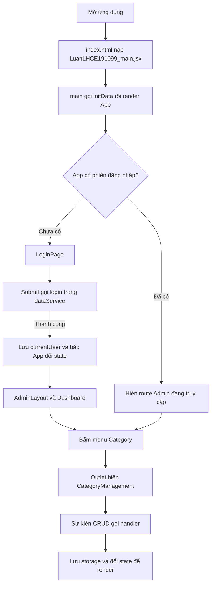

# Assignment 1 - Đọc theo luồng rồi mở từng file

Đọc tài liệu này cùng project `D:\SBA301\baitaptuhoctungslot\LuanLH_Assignment01`.

Mỗi lần học một luồng: thực hiện thao tác trên trình duyệt, mở file theo thứ tự bên dưới, tìm hàm được nhắc đến rồi quan sát kết quả. Chưa cần đọc hết các file hoặc học hết cú pháp trước.

Project này lưu dữ liệu mẫu bằng `localStorage` trong trình duyệt. `LuanLHCE191099_dataService.js` là nơi đọc/ghi dữ liệu đó. Các luồng dưới đây không gọi backend.

## Lộ trình đọc

| Lượt | Theo dõi việc gì? | Đọc phần nào? |
|---|---|---|
| 1 | Mở ứng dụng và thấy Login | [Luồng 1](#luong-1) |
| 2 | Gõ tài khoản và đăng nhập | [Luồng 2](#luong-2) |
| 3 | Thấy khung Admin và mở Category | [Luồng 3](#luong-3) |
| 4 | Thêm, sửa, xóa và tìm Category | [Luồng 4](#luong-4) |
| 5 | Áp dụng cùng cách đọc sang News và Users | [Luồng 5](#luong-5) |
| 6 | Logout và F5 | [Luồng 6](#luong-6) |

Thứ tự này là thứ tự học. Trong lúc chạy, một file có thể được dùng ở nhiều luồng: `LuanLHCE191099_dataService.js` chẳng hạn được gọi khi chuẩn bị dữ liệu, đăng nhập và lưu CRUD.



<a id="luong-1"></a>

## Luồng 1. Từ npm run dev đến màn hình Login

Giả sử anh mở `/` và chưa có key `currentUser` từ lần đăng nhập trước. Nếu đã có phiên, App có thể đưa anh vào Admin ngay; có thể bấm Logout để quan sát luồng Login.

### Bước 1. package.json: chọn lệnh khởi động

Mở [package.json](D:/SBA301/baitaptuhoctungslot/LuanLH_Assignment01/package.json:7), tìm:

```json
"scripts": {
  "dev": "vite",
  "build": "vite build",
  "lint": "oxlint",
  "preview": "vite preview"
}
```

Anh gõ `npm run dev` thì npm chạy script `dev`, tức `vite`. Vite khởi động máy chủ phục vụ ứng dụng và in URL. Anh mở URL đó thì trình duyệt tải trang và thực thi code phía client.

**Đi tiếp:** file HTML mà trình duyệt tải là `index.html`.

### Bước 2. index.html: khai báo chỗ hiển thị và file đầu vào

Mở [index.html](D:/SBA301/baitaptuhoctungslot/LuanLH_Assignment01/index.html:10):

```html
<div id="root"></div>
<script type="module" src="/src/LuanLHCE191099_main.jsx"></script>
```

- `root` là phần tử DOM để React đặt giao diện vào.
- Thẻ script chỉ đến module `LuanLHCE191099_main.jsx`, được Vite xử lý để phục vụ trình duyệt.

Ở đây chưa có Login hay bảng Category. HTML chỉ cung cấp chỗ gắn ứng dụng.

**Đi tiếp:** mở `LuanLHCE191099_main.jsx`.

### Bước 3. LuanLHCE191099_main.jsx: chuẩn bị dữ liệu rồi yêu cầu React hiển thị App

Mở [LuanLHCE191099_main.jsx](D:/SBA301/baitaptuhoctungslot/LuanLH_Assignment01/src/LuanLHCE191099_main.jsx:9):

```jsx
initData();

ReactDOM.createRoot(document.getElementById('root')).render(
  <React.StrictMode>
    <App />
  </React.StrictMode>,
)
```

Đọc hai việc chính theo thứ tự:

1. `initData()` chạy trước để bảo đảm có dữ liệu mẫu cần thiết.
2. `createRoot(...).render(...)` yêu cầu React hiển thị cây component bắt đầu từ App vào `root`.

Các import ở đầu file đưa App, hàm initData và CSS vào ứng dụng. Import App không có nghĩa mọi handler bên trong App hoặc các page đã chạy; React và các sự kiện quyết định lúc gọi chúng.

**Đi theo lời gọi thứ nhất:** `initData` được import từ `LuanLHCE191099_dataService.js`.

### Bước 4. LuanLHCE191099_dataService.js: initData chuẩn bị ba mảng mẫu

Mở [LuanLHCE191099_dataService.js - initData](D:/SBA301/baitaptuhoctungslot/LuanLH_Assignment01/src/services/LuanLHCE191099_dataService.js:17). Nhìn nhánh Category trước:

```js
if (!localStorage.getItem('categories')) {
  localStorage.setItem('categories', JSON.stringify(initialCategories));
}
```

Hàm kiểm tra key `categories`. Nếu chưa có, nó đổi mảng mẫu thành chuỗi JSON rồi ghi vào storage. `users` và `news` cũng được khởi tạo khi thiếu.

Nếu đã có dữ liệu từ lần trước thì giữ lại. Vì vậy F5 không tự ghi đè các Category anh đã thêm. Nhánh users còn có đoạn chuyển tài khoản mẫu cũ `admin/123` thành `Admin/Admin`; đó là xử lý dữ liệu mẫu cũ của project.

`initData()` làm xong thì quay về `LuanLHCE191099_main.jsx`, tiếp tục phần render App.

**Đi tiếp:** mở App.

### Bước 5. LuanLHCE191099_App.jsx: kiểm tra có phiên đăng nhập không

Mở [LuanLHCE191099_App.jsx](D:/SBA301/baitaptuhoctungslot/LuanLH_Assignment01/src/LuanLHCE191099_App.jsx:13):

```jsx
const [isAuthenticated, setIsAuthenticated] = useState(
  () => Boolean(getCurrentUser())
);
```

Lần đầu khởi tạo App, hàm này lấy user đang đăng nhập từ storage. `Boolean(...)` đổi kết quả thành true/false để App chọn giao diện.

Theo tiếp vào [getCurrentUser](D:/SBA301/baitaptuhoctungslot/LuanLH_Assignment01/src/services/LuanLHCE191099_dataService.js:86):

```js
export const getCurrentUser = () => {
  const userStr = localStorage.getItem('currentUser');
  return userStr ? JSON.parse(userStr) : null;
};
```

Không có phiên thì trả `null`, nên state ban đầu là `false`. Có chuỗi phiên thì parse về object; phiên giả lập này chưa được xác minh lại với server.

Quay lại App và tìm route `/`:

```jsx
isAuthenticated
  ? <AdminLayout onLogout={handleLogout} />
  : <Navigate to="/login" />
```

State đang false nên Router chuyển sang `/login`. Route Login khi chưa đăng nhập trả về `<LoginPage onLogin={handleLogin} />`.

### Bước 6. LuanLHCE191099_LoginPage.jsx: hiện form, chờ người dùng

Mở [LuanLHCE191099_LoginPage.jsx](D:/SBA301/baitaptuhoctungslot/LuanLH_Assignment01/src/pages/LuanLHCE191099_LoginPage.jsx:5). Ba state ban đầu là:

```jsx
const [username, setUsername] = useState('');
const [password, setPassword] = useState('');
const [error, setError] = useState('');
```

Hai ô input đang rỗng; error rỗng nên chưa có cảnh báo. JSX trong phần return tạo form Login.

Hàm `handleSubmit` đã được khai báo nhưng lúc này chưa chạy. Nó chờ sự kiện submit của form.

**Đến đây anh cần thấy được đường đi:**

```text
package.json chọn vite
→ trình duyệt tải index.html
→ LuanLHCE191099_main.jsx gọi initData trong dataService
→ LuanLHCE191099_main.jsx render App
→ App đọc currentUser và chọn route
→ LoginPage hiện form
```

<a id="luong-2"></a>

## Luồng 2. Gõ Admin/Admin rồi bấm Login

Mở các file theo thứ tự: LoginPage → dataService → App. Mình sẽ quay lại file cũ theo lời gọi hàm, thay vì đọc hết một file rồi bỏ qua.

### Bước 1. LoginPage nhận nội dung anh gõ

Trong [LuanLHCE191099_LoginPage.jsx](D:/SBA301/baitaptuhoctungslot/LuanLH_Assignment01/src/pages/LuanLHCE191099_LoginPage.jsx), nhìn input Username:

```jsx
value={username}
onChange={(e) => setUsername(e.target.value)}
```

Anh gõ `Admin` → `onChange` nhận nội dung ô → `setUsername('Admin')` yêu cầu cập nhật state → render tiếp theo dùng username mới. Password đi tương tự qua `setPassword`.

`value` lấy từ state; `onChange` đưa thay đổi trở về state. Cách nối này gọi là controlled input.

### Bước 2. Submit gọi handleSubmit

Form được nối bằng:

```jsx
<Form onSubmit={handleSubmit}>
```

Nút Login có `type="submit"`. Bấm nút kích hoạt submit và chạy [handleSubmit](D:/SBA301/baitaptuhoctungslot/LuanLH_Assignment01/src/pages/LuanLHCE191099_LoginPage.jsx:10):

```jsx
const handleSubmit = (e) => {
  e.preventDefault();
  setError('');

  if (!username || !password) {
    setError('Please enter both username and password.');
    return;
  }

  const res = login(username, password);
  if (res.success) {
    onLogin();
  } else {
    setError(res.message);
  }
};
```

| Thứ tự | Đang làm gì? |
|---|---|
| 1 | `preventDefault` ngăn submit mặc định tải/chuyển trang |
| 2 | Xóa thông báo lỗi cũ |
| 3 | Nếu thiếu một trong hai ô, đặt lỗi rồi `return` để dừng |
| 4 | Gọi `login(username, password)` trong service |
| 5 | Nhận kết quả; thành công thì gọi callback, thất bại thì hiện lỗi |

**Tạm dừng ở dòng login và đi vào service.**

### Bước 3. dataService tìm tài khoản phù hợp

Mở [LuanLHCE191099_dataService.js - login](D:/SBA301/baitaptuhoctungslot/LuanLH_Assignment01/src/services/LuanLHCE191099_dataService.js:62):

```js
const users = getUsers();
const user = users.find(
  u => u.username === username && u.password === password
);
```

Đường gọi tiếp bên trong file này:

```text
getUsers()
→ getItems('users')
→ localStorage.getItem('users')
→ JSON.parse(...)
→ trả về mảng tài khoản
```

`find` lần lượt xét tài khoản trong mảng, chọn object đầu tiên khớp cả username và password. Đây là so sánh chính xác, nên `Admin` khác `admin`.

Nếu tìm được, code kiểm tra `user.role === 1`. Admin có role 1 nên được chấp nhận; tài khoản Staff mẫu role 2 bị từ chối. Hàm hiện chưa dùng status để quyết định đăng nhập.

### Bước 4. dataService lưu phiên rồi trả kết quả về LoginPage

Trong nhánh Admin, service tạo `authenticatedUser` gồm id, username, role và status, rồi:

```js
localStorage.setItem('currentUser', JSON.stringify(authenticatedUser));
return { success: true, user: authenticatedUser };
```

`currentUser` là phiên mẫu dùng cho những lần đọc sau, không chứa password. Sau `return`, luồng quay lại dòng `const res = login(...)` trong LoginPage.

Lúc này `res.success` là true nên LoginPage gọi `onLogin()`.

### Bước 5. onLogin chạy hàm ở App

Quay lại [LuanLHCE191099_App.jsx](D:/SBA301/baitaptuhoctungslot/LuanLH_Assignment01/src/LuanLHCE191099_App.jsx:15):

```jsx
const handleLogin = () => {
  setIsAuthenticated(true);
};
```

Khi tạo LoginPage, App đã truyền hàm đó xuống:

```jsx
<LoginPage onLogin={handleLogin} />
```

Vì vậy `onLogin()` bên con là gọi hàm `handleLogin` của cha. Callback này yêu cầu App đổi state thành true, rồi React tính lại giao diện.

Route `/login` lúc đã đăng nhập trả về `<Navigate to="/" />`. Tới `/`, App cho hiển thị AdminLayout và route con Dashboard.

**Hai việc cần tách rõ:**

| Lệnh | Tác dụng |
|---|---|
| Lưu `currentUser` | Giữ thông tin phiên trong storage để có thể đọc lại |
| `setIsAuthenticated(true)` | Làm App hiện tại phản ứng với việc đăng nhập |

Luồng đầy đủ:

```text
LoginPage: submit
→ handleSubmit
→ dataService.login
→ đọc users, tìm tài khoản và kiểm tra role
→ lưu currentUser, trả success: true
→ LoginPage gọi onLogin
→ App.handleLogin đổi state
→ Router chuyển /login về /
→ AdminLayout và Dashboard xuất hiện
```

<a id="luong-3"></a>

## Luồng 3. Khung Admin, Dashboard và menu Category

### Bước 1. AdminLayout ghép ba phần giao diện

Mở [LuanLHCE191099_AdminLayout.jsx](D:/SBA301/baitaptuhoctungslot/LuanLH_Assignment01/src/components/Layout/LuanLHCE191099_AdminLayout.jsx:6). Phần chính là Header, Sidebar và Outlet bên trong main.

| Thành phần | Nhiệm vụ |
|---|---|
| Header | Thanh trên: logo, username, Logout |
| Sidebar | Menu chọn màn hình |
| Outlet | Vị trí Router hiển thị page con phù hợp URL |

`<Header onLogout={onLogout} />` chuyển tiếp callback Logout App đã truyền xuống layout. Layout không tự xử lý xóa phiên.

### Bước 2. Header đọc tên, Dashboard đọc số lượng

Mở [LuanLHCE191099_Header.jsx](D:/SBA301/baitaptuhoctungslot/LuanLH_Assignment01/src/components/Layout/LuanLHCE191099_Header.jsx:6). `getCurrentUser()` đọc phiên, JSX lấy `user?.username` để hiển thị tên.

Mở [LuanLHCE191099_DashboardPage.jsx](D:/SBA301/baitaptuhoctungslot/LuanLH_Assignment01/src/pages/LuanLHCE191099_DashboardPage.jsx:5):

```jsx
const categoriesCount = getCategories().length;
const newsCount = getNews().length;
const usersCount = getUsers().length;
```

Route index ở App chọn Dashboard khi URL là `/`. Dashboard đọc ba mảng từ storage, lấy số phần tử rồi hiện ba Card. Nó đếm cả Active và Inactive.

### Bước 3. Bấm Category: Sidebar đổi URL

Mở [LuanLHCE191099_Sidebar.jsx](D:/SBA301/baitaptuhoctungslot/LuanLH_Assignment01/src/components/Layout/LuanLHCE191099_Sidebar.jsx:17):

```jsx
<Nav.Link as={NavLink} to="/category" className="text-white">
```

`to="/category"` là địa chỉ cần chuyển tới. `as={NavLink}` cho link dùng cơ chế điều hướng của React Router.

Quay lại [LuanLHCE191099_App.jsx](D:/SBA301/baitaptuhoctungslot/LuanLH_Assignment01/src/LuanLHCE191099_App.jsx:34):

```jsx
<Route path="category" element={<CategoryManagement />} />
```

Đây là route con trong route cha `/`. Khi URL là `/category`, Outlet trong AdminLayout hiển thị CategoryManagement. Header và Sidebar tiếp tục là khung chung.

### Bước 4. CategoryManagement đọc dữ liệu để vẽ bảng

Mở [LuanLHCE191099_CategoryManagement.jsx](D:/SBA301/baitaptuhoctungslot/LuanLH_Assignment01/src/pages/LuanLHCE191099_CategoryManagement.jsx:7):

```jsx
const [categories, setCategories] = useState(() => getCategories());
const [searchKw, setSearchKw] = useState('');
```

Khi page được khởi tạo, nó đọc mảng Category qua [getCategories](D:/SBA301/baitaptuhoctungslot/LuanLH_Assignment01/src/services/LuanLHCE191099_dataService.js:52):

```js
export const getCategories = () => getItems('categories');
```

Hàm getItems đọc chuỗi storage và parse về mảng. Kết quả làm state ban đầu của page; initializer này không tự đăng ký theo dõi thay đổi storage.

Trong page, `filteredCategories` chọn dữ liệu cần hiển thị theo searchKw; sau đó `map` biến mỗi object thành một `<tr>` của bảng.

```text
Sidebar đổi URL
→ App khớp route Category
→ Outlet hiển thị CategoryManagement
→ page đọc getCategories để có state ban đầu
→ lọc theo từ khóa
→ map tạo các dòng JSX
→ bảng xuất hiện
```

<a id="luong-4"></a>

## Luồng 4. Thực hành một vòng CRUD với Category

Từ đây anh chủ yếu đứng ở CategoryManagement. Chỉ mở service khi đi tới lời gọi đọc/lưu dữ liệu.

### A. Bấm Add Category

Nút Add có `onClick={handleShowAdd}`. Bấm vào thì chạy [handleShowAdd](D:/SBA301/baitaptuhoctungslot/LuanLH_Assignment01/src/pages/LuanLHCE191099_CategoryManagement.jsx:28):

```jsx
const handleShowAdd = () => {
  setIsEdit(false);
  setFormData({ name: '', status: 1 });
  setCurrentId(null);
  setShowModal(true);
};
```

| State được đổi | Ý nghĩa |
|---|---|
| isEdit = false | Chuẩn bị thêm mới |
| formData có tên rỗng, status 1 | Bản nháp mới, mặc định Active |
| currentId = null | Không nhắm tới bản ghi cũ |
| showModal = true | Hiện popup form |

Những setter này yêu cầu cập nhật cho render tiếp theo. Chưa có dữ liệu Category nào được lưu chỉ vì anh mở popup.

### B. Gõ vào form

Trong input Name:

```jsx
value={formData.name}
onChange={(e) => setFormData({ ...formData, name: e.target.value })}
```

Anh nhập `Practice Category`: formData giữ tên mới, còn `...formData` giữ các trường khác như status. Đây vẫn là bản nháp; bảng nguồn chưa bị thay đổi.

### C. Bấm Save: kiểm tra rồi chọn nhánh thêm hoặc sửa

Mở [handleSave](D:/SBA301/baitaptuhoctungslot/LuanLH_Assignment01/src/pages/LuanLHCE191099_CategoryManagement.jsx:42). Nó bắt đầu bằng:

```js
if (!formData.name.trim()) {
  setFormError('Name is required');
  return;
}
```

Tên rỗng hoặc toàn khoảng trắng thì đặt lỗi và dừng. `trim()` ở đây dùng để kiểm tra; code lưu vẫn dùng tên gốc trong formData.

Tiếp theo:

```js
let updatedCats = [...categories];
```

Tạo mảng làm việc mới. Vì lúc mở Add đã đặt isEdit false, handler chạy nhánh thêm:

```js
const newId = updatedCats.length > 0
  ? Math.max(...updatedCats.map(c => c.id)) + 1
  : 1;

updatedCats.push({
  id: newId,
  ...formData,
  status: Number(formData.status)
});
```

Id là số lớn nhất trong mảng cộng 1; nếu rỗng thì lấy 1. Ví dụ mảng có id 1, 2, 3 thì bản ghi mới có id 4. Status từ dropdown được đổi về số để thống nhất với các điều kiện `status === 1`.

### D. Save đi vào service, rồi quay lại đổi state

Cuối handleSave:

```js
saveCategories(updatedCats);
setCategories(updatedCats);
handleCloseModal();
```

Đi vào [LuanLHCE191099_dataService.js - saveCategories](D:/SBA301/baitaptuhoctungslot/LuanLH_Assignment01/src/services/LuanLHCE191099_dataService.js:53):

```js
export const saveCategories = (cats) => saveItems('categories', cats);
```

Hàm này gọi saveItems:

```js
const saveItems = (key, items) =>
  localStorage.setItem(key, JSON.stringify(items));
```

Nó đổi cả mảng thành JSON và ghi lại key categories. Lưu xong quay về handleSave:

- `setCategories` yêu cầu page dùng mảng mới ở render tiếp theo.
- `handleCloseModal` ẩn popup và xóa thông báo lỗi form.
- Page tính lại bộ lọc rồi vẽ bảng từ state mới.

Nếu từ khóa hiện tại không khớp tên vừa thêm, bản ghi đã lưu vẫn có thể chưa xuất hiện trong bảng đang lọc. Xóa từ khóa để nhìn toàn bộ.

**Luồng Create anh cần đọc được:**

```text
Add → handleShowAdd → form nháp
→ gõ input → setFormData
→ Save → handleSave kiểm tra input
→ tạo mảng mới và thêm object
→ saveCategories → saveItems → ghi localStorage
→ quay lại setCategories → đóng form
→ React render bảng mới
```

### E. Sửa Category vừa tạo

Nút Edit ở mỗi dòng có `onClick={() => handleShowEdit(c)}`. Biến c chính là object của dòng được bấm; hàm nhỏ bao ngoài giúp truyền object đó lúc click.

Đi vào [handleShowEdit](D:/SBA301/baitaptuhoctungslot/LuanLH_Assignment01/src/pages/LuanLHCE191099_CategoryManagement.jsx:35):

```jsx
setIsEdit(true);
setFormData({ name: category.name, status: category.status });
setCurrentId(category.id);
setShowModal(true);
```

Lần này popup có dữ liệu cũ, isEdit true và currentId là id đích. Gõ tên mới vẫn chỉ đổi bản nháp formData.

Bấm Save vẫn chạy handleSave cũ. Sau validation, vì isEdit true nên chạy nhánh:

```js
updatedCats = updatedCats.map(c =>
  c.id === currentId
    ? { ...c, ...formData, status: Number(formData.status) }
    : c
);
```

`map` tạo mảng mới: phần tử đúng id được thay bằng object ghép dữ liệu cũ với bản nháp; phần tử khác được giữ. Mảng không tự tăng số lượng khi sửa.

Sau đó vẫn là saveCategories → ghi storage → setCategories → đóng form → render.

**Một form dùng được cho cả hai việc vì:**

| Khi mở form | Nhánh khi Save | Bản ghi đích |
|---|---|---|
| Add đặt isEdit false | Thêm object mới | Sinh id mới |
| Edit đặt isEdit true | map thay object | currentId |

Bấm Cancel chỉ đóng form, không gọi saveCategories. Vì vậy bản nháp chưa được ghi vào danh sách thật.

### F. Xóa Category vừa tạo

Nút Trash gọi `confirmDelete(c.id)`, chưa gọi thẳng handleDelete.

Mở [confirmDelete](D:/SBA301/baitaptuhoctungslot/LuanLH_Assignment01/src/pages/LuanLHCE191099_CategoryManagement.jsx:61):

```js
const categoryIsUsed = getNews().some(
  newsItem => Number(newsItem.categoryId) === Number(id)
);
```

Lại đi qua service, nhưng lần này đọc key news. `some` kiểm tra có bài tin nào đang trỏ đến Category này không.

- Nếu có: hiện alert rồi dừng, Category còn nguyên.
- Nếu chưa dùng: lưu deleteId và đặt showDeleteModal true để hiện xác nhận.

Anh bấm Delete trong hộp xác nhận mới chạy [handleDelete](D:/SBA301/baitaptuhoctungslot/LuanLH_Assignment01/src/pages/LuanLHCE191099_CategoryManagement.jsx:71):

```js
const updatedCats = categories.filter(c => c.id !== deleteId);
saveCategories(updatedCats);
setCategories(updatedCats);
setShowDeleteModal(false);
```

`filter` giữ những phần tử có id khác deleteId. Lưu mảng đó vào storage, cập nhật state rồi đóng xác nhận. Cancel chỉ đóng xác nhận, không đi vào nhánh này.

```text
Trash → confirmDelete
→ đọc News để kiểm tra Category đang dùng
→ nếu hợp lệ thì mở xác nhận
→ anh bấm Delete → handleDelete
→ filter loại bản ghi → lưu storage → đổi state → bảng cập nhật
```

Muốn thử luồng xóa thành công, dùng Category thử chưa được bài News nào tham chiếu. Category Technology hoặc Sports trong dữ liệu mẫu ban đầu đã có News tham chiếu nên có thể bị chặn đúng logic.

### G. Tìm kiếm trong Category

Input tìm kiếm có `value={searchKw}` và gọi `setSearchKw(e.target.value)` khi anh gõ. Render tiếp theo tính lại [filteredCategories](D:/SBA301/baitaptuhoctungslot/LuanLH_Assignment01/src/pages/LuanLHCE191099_CategoryManagement.jsx:78):

```js
const filteredCategories = categories.filter(c =>
  c.name.toLowerCase().includes(searchKw.toLowerCase())
);
```

| Biến | Hiểu theo vai trò |
|---|---|
| categories | Danh sách nguồn của page |
| searchKw | Nội dung ô tìm kiếm |
| filteredCategories | Những phần tử nguồn cần hiển thị ở render này |

JSX map filteredCategories thành dòng bảng. Tìm kiếm không gọi saveCategories và không ghi đè mảng nguồn. Xóa sạch từ khóa thì mọi tên đều chứa chuỗi rỗng, nên toàn bộ nguồn hiện lại.

**Anh đã học đủ một vòng:** Read lấy nguồn → Create thêm object → Update thay object → Delete loại object → Search chọn phần cần hiện.

<a id="luong-5"></a>

## Luồng 5. Từ Category chuyển sang News và Users

Hai page này dùng lại cùng mẫu sự kiện và state. Đọc từng page theo thứ tự: state ban đầu → nút Add/Edit/Delete → handler → service → setter → JSX. Tập trung vào những phần khác Category bên dưới.

### A. LuanLHCE191099_NewsManagement.jsx

Mở [LuanLHCE191099_NewsManagement.jsx](D:/SBA301/baitaptuhoctungslot/LuanLH_Assignment01/src/pages/LuanLHCE191099_NewsManagement.jsx:6).

```text
Bấm menu News
→ App khớp /news
→ Outlet hiện NewsManagement
→ đọc news, categories, users từ service
→ tạo bảng tin cùng tên Category và tác giả
```

| Điểm cần tìm trong file | Nó làm gì? |
|---|---|
| newsList | Mảng News dùng để CRUD |
| categories và users | Hai mảng để hiện lựa chọn và tra cứu tên |
| handleShowAdd / handleShowEdit | Chuẩn bị form tương tự Category |
| handleSave | Chặn Title rỗng và chưa chọn Category; thêm/sửa News |
| saveNews / setNewsList | Lưu key news và cập nhật UI |
| getCategoryName / getUserName | Đổi id trong News thành tên dễ đọc |
| handleDelete / filteredNews | Xóa sau xác nhận / tìm theo Title |

Xem hai hàm tra tên ở [đầu file](D:/SBA301/baitaptuhoctungslot/LuanLH_Assignment01/src/pages/LuanLHCE191099_NewsManagement.jsx:25):

```js
const getCategoryName = (id) =>
  categories.find(c => c.id === Number(id))?.name || 'Unknown';

const getUserName = (id) =>
  users.find(u => u.id === Number(id))?.username || 'Unknown';
```

Ví dụ News có categoryId 1: tìm Category id 1, lấy tên Technology để hiển thị. News chỉ lưu id liên quan, không cần chép toàn bộ Category vào từng bài tin. Không tìm được thì hiện Unknown.

Khi thêm mới, [handleSave](D:/SBA301/baitaptuhoctungslot/LuanLH_Assignment01/src/pages/LuanLHCE191099_NewsManagement.jsx:53) đọc currentUser và gán `createdBy: currentUser.id`. Khi sửa, formData không thay createdBy nên giữ tác giả cũ.

```text
Add News → chuẩn bị bản nháp
→ nhập Title, Content, Tags, chọn Category/Status
→ Save kiểm tra Title và Category
→ tạo object, lấy createdBy từ phiên đăng nhập
→ saveNews ghi storage
→ setNewsList, đóng form, render lại
```

Tags hiện là chuỗi như `react, js`. Content và Tags chưa phải trường bắt buộc theo validation hiện có.

### B. LuanLHCE191099_UserManagement.jsx

Mở [LuanLHCE191099_UserManagement.jsx](D:/SBA301/baitaptuhoctungslot/LuanLH_Assignment01/src/pages/LuanLHCE191099_UserManagement.jsx:6).

```text
Bấm menu Users → App chọn route → Outlet hiện UserManagement
→ getUsers đọc nguồn → tìm kiếm → map tạo bảng
→ Add/Edit/Delete chạy theo cùng mẫu Category
```

| Điểm riêng | Tìm ở đâu? |
|---|---|
| formData có username, password, role, status | Các khai báo state đầu file |
| Chặn username/password rỗng hoặc toàn khoảng trắng | Đầu handleSave |
| Chặn trùng username với tài khoản khác | Biến isDuplicate |
| Đổi role/status về số trước khi lưu | Hai nhánh thêm/sửa |
| Chặn xóa chính tài khoản đang đăng nhập | confirmDelete |
| Lưu dữ liệu và cập nhật bảng | saveUsers rồi setUsers |

Trong [handleSave](D:/SBA301/baitaptuhoctungslot/LuanLH_Assignment01/src/pages/LuanLHCE191099_UserManagement.jsx:47):

```js
const isDuplicate = updatedUsers.some(
  u => u.username === formData.username && u.id !== currentId
);
```

`some` tìm xem có tài khoản khác đang dùng username đó không. `u.id !== currentId` giúp tài khoản đang sửa không bị xem là trùng với chính nó.

Đến [confirmDelete](D:/SBA301/baitaptuhoctungslot/LuanLH_Assignment01/src/pages/LuanLHCE191099_UserManagement.jsx:84), page đọc currentUser rồi so id trước khi mở xác nhận. Hiện code chặn tự xóa, chưa chặn xóa tác giả của News khác. Vì vậy luồng xóa User và Category có quy tắc khác nhau.

### C. LuanLHCE191099_SettingsPage.jsx

Mở [LuanLHCE191099_SettingsPage.jsx](D:/SBA301/baitaptuhoctungslot/LuanLH_Assignment01/src/pages/LuanLHCE191099_SettingsPage.jsx:5):

```text
Bấm Settings → route /settings → Outlet hiện SettingsPage
→ getCurrentUser → JSX hiện username và role
```

Trang này hiện chỉ đọc và hiển thị hồ sơ phiên đăng nhập, chưa có form sửa cài đặt. Role 1 hiện Admin, nhánh còn lại hiện Staff.

<a id="luong-6"></a>

## Luồng 6. Logout và F5

### A. Logout

Quay lại [LuanLHCE191099_Header.jsx](D:/SBA301/baitaptuhoctungslot/LuanLH_Assignment01/src/components/Layout/LuanLHCE191099_Header.jsx:9). Nút Logout gọi:

```jsx
const handleLogout = () => {
  logout();
  onLogout();
};
```

1. `logout()` đi vào [LuanLHCE191099_dataService.js](D:/SBA301/baitaptuhoctungslot/LuanLH_Assignment01/src/services/LuanLHCE191099_dataService.js:82), xóa key currentUser.
2. Quay lại Header, `onLogout()` gọi callback App đã truyền qua AdminLayout.
3. [App.handleLogout](D:/SBA301/baitaptuhoctungslot/LuanLH_Assignment01/src/LuanLHCE191099_App.jsx:19) yêu cầu đặt isAuthenticated false.
4. Render tiếp theo, route Admin trả Navigate tới `/login`; LoginPage xuất hiện.

```text
Header click Logout
→ service xóa currentUser
→ Header gọi callback
→ App đổi state
→ Router chuyển về Login
```

Logout không xóa các mảng users, categories và news. Đăng nhập lại vẫn thấy dữ liệu đã lưu.

### B. F5

F5 tải lại ứng dụng nên đi lại luồng 1. State React được khởi tạo mới, còn storage của origin vẫn có thể giữ dữ liệu.

| Chỗ đọc lại | Điều gì được khôi phục? |
|---|---|
| initData | Giữ các mảng đã lưu, tạo mẫu khi thiếu key |
| App gọi getCurrentUser | Biết còn phiên mẫu hay chưa |
| Page gọi getCategories/getNews/getUsers khi khởi tạo | Đọc lại các bản ghi đã lưu |

**Đây là lý do CRUD cần cả hai lệnh:**

```js
saveCategories(updatedCats);
setCategories(updatedCats);
```

Lệnh đầu lưu cho lần đọc sau; lệnh sau cập nhật dữ liệu để React vẽ page hiện tại. Storage và state không tự đồng bộ trong project này.

## Các file còn lại: chỉ mở khi cần mục đích tương ứng

| File | Anh mở khi nào? |
|---|---|
| [vite.config.js](D:/SBA301/baitaptuhoctungslot/LuanLH_Assignment01/vite.config.js) | Muốn xem cấu hình công cụ chạy/build; hiện bật plugin React |
| [LuanLHCE191099_index.css](D:/SBA301/baitaptuhoctungslot/LuanLH_Assignment01/src/LuanLHCE191099_index.css) | Muốn xem CSS riêng; hiện là margin/padding body và font |
| [LuanLHCE191099_main.jsx](D:/SBA301/baitaptuhoctungslot/LuanLH_Assignment01/src/LuanLHCE191099_main.jsx:4) | Muốn tìm nơi import Bootstrap CSS và CSS riêng |
| [TEST_MATRIX.md](D:/SBA301/baitaptuhoctungslot/LuanLH_Assignment01/TEST_MATRIX.md) | Thực hiện và ghi nhận các trường hợp kiểm tra UI |
| [README.md](D:/SBA301/baitaptuhoctungslot/LuanLH_Assignment01/README.md) | Tra lệnh chạy, tài khoản mẫu và phạm vi project |

## Khi bị lạc giữa nhiều file

Quay về thao tác anh vừa làm rồi tìm đúng điểm bắt đầu:

| Anh đang hỏi điều gì? | File/hàm bắt đầu đọc |
|---|---|
| Vì sao hiện Login hoặc Admin? | App: isAuthenticated và Routes |
| Bấm Login chạy gì? | LoginPage: Form.onSubmit và handleSubmit |
| Tài khoản được tìm ở đâu? | dataService: login, getUsers, getItems |
| Menu đổi trang thế nào? | Sidebar → route ở App → Outlet |
| Vì sao popup mở? | Page: handleShowAdd hoặc handleShowEdit |
| Bấm Save ghi vào đâu? | Page.handleSave → save... trong dataService |
| Vì sao sửa đúng dòng? | currentId và map trong handleSave |
| Vì sao xóa bị chặn? | confirmDelete của page tương ứng |
| Vì sao tìm kiếm hiện lại đủ khi xóa từ khóa? | searchKw và filtered... |
| Vì sao F5 vẫn còn dữ liệu? | Hàm lưu storage và initializer đọc lại |

Mỗi lần chỉ lần theo bốn ý: **sự kiện bắt đầu → hàm xử lý → dữ liệu/state đổi → kết quả giao diện**. Một file có thể xuất hiện nhiều lần trong chuỗi; đó là cách các hàm phối hợp.

Muốn tra kỹ cú pháp, CSS hoặc các giới hạn khác, xem [tài liệu chi tiết](D:/SBA301/baitaptuhoctungslot/LuanLH_Assignment01/HUONG_DAN_ASSIGNMENT01_CHI_TIET.md). Bản chi tiết là phần tra cứu sau khi anh đã nối được các luồng trên.
